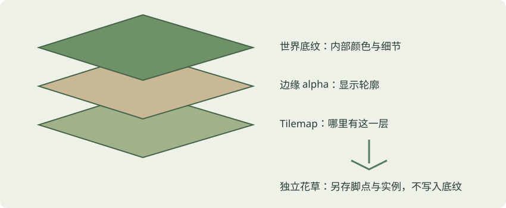
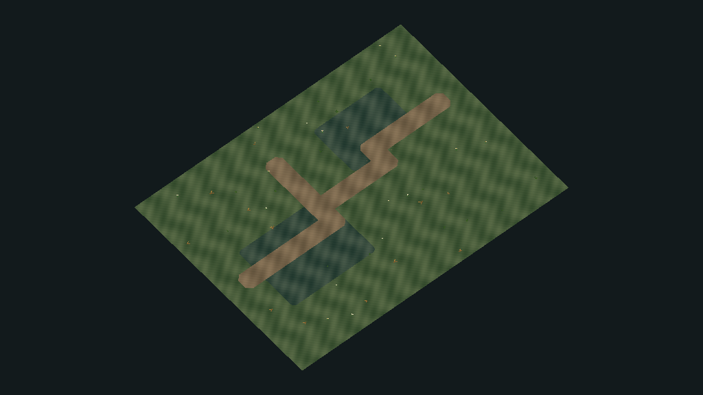
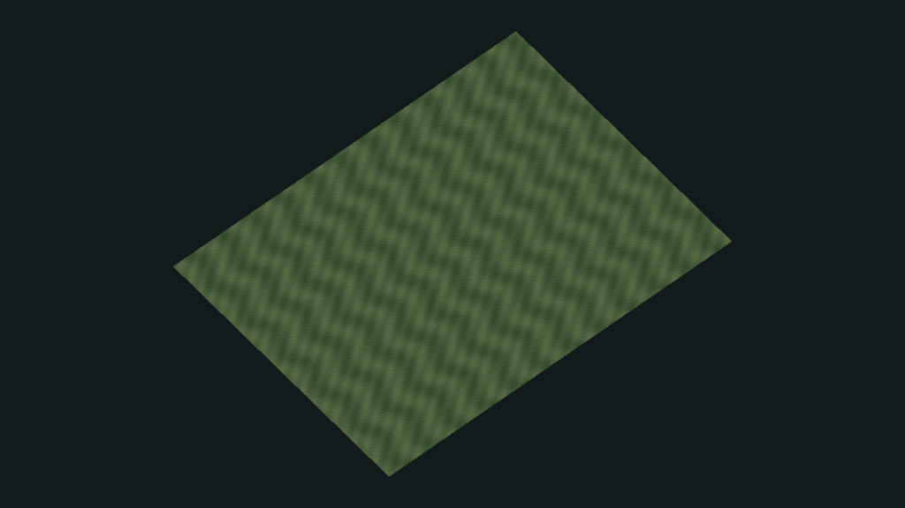
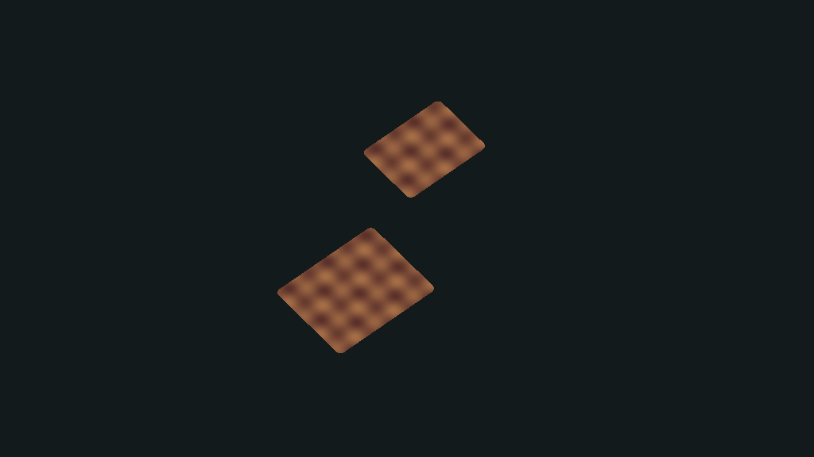
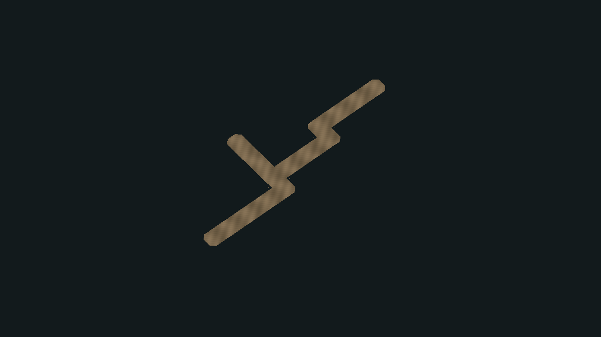
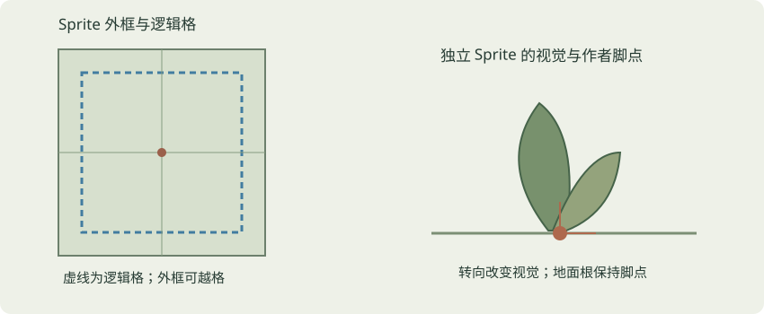
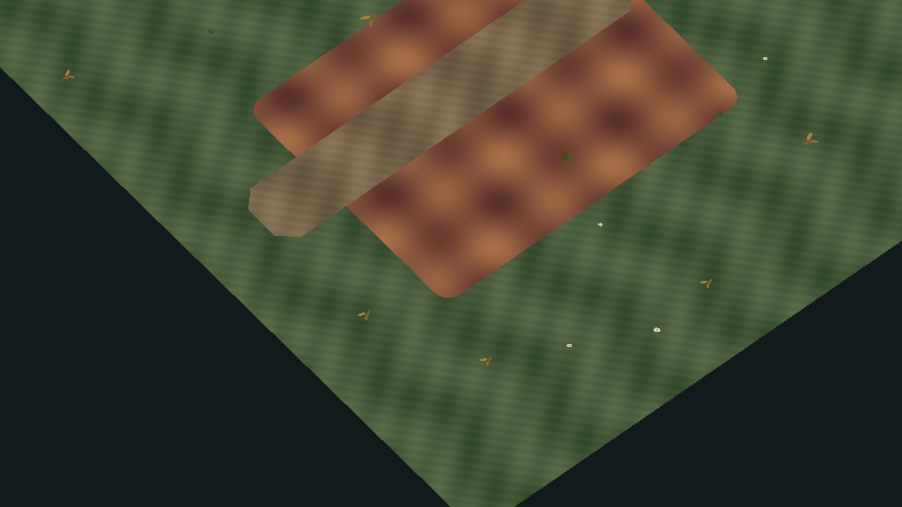
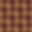
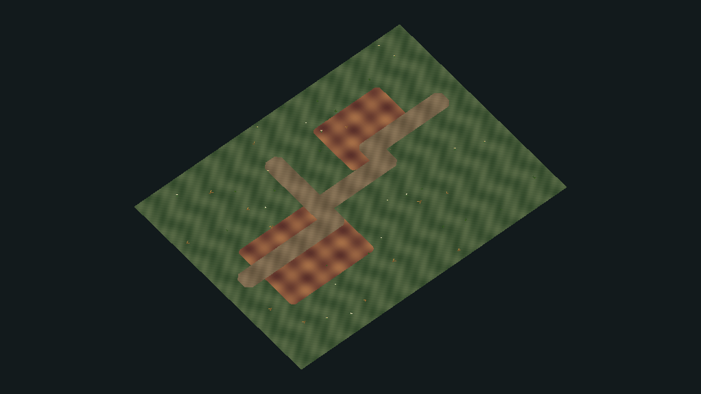

# 地面组合逻辑教程

从一张底纹，到可以保存、复用和试玩的地图。本文对应 Unity 菜单 **Tools → OSSASTRA → 星骸地表工坊**，不是原作者编辑器的复原说明。技术验收、实际截图与未测项以本轮开始使用页和验收报告为准；示意图均明确标记为自有讲解图。

**UI_PHYSICAL_UNVERIFIED**　当前真实桌面输入工具不可用，尚未通过物理鼠标完成工坊流程，也没有把编辑器主窗口的实际截图补作通过证据。自动SceneView事件、Scene/Game渲染截图和程序合同各自记录，不能合并冒称人工操作已验收。

## 1　先看结果，再拆组成

**看什么**　地面可以分成三件事：格子记录哪里有这一层；边缘族决定轮廓；底纹决定轮廓内部的颜色与细节。独立花草另外保存脚点和变换，不等于底纹里画的小花。

下面是同一套原创技术地图的实际分解：192格基础、32格覆盖、19格四邻接连通的弯路与分叉，44个原创装饰。所有帧为 **NativeCamera.Render完整1024×576**，拆层帧临时隐藏装饰；不是Editor窗口实拍，也不是原作场景或正式美术。

**做什么**　在制作地图页选一层，点“只看当前层”，再点“查看边缘 alpha”。用吸管点一格，查看实际 Tile、规则选出的 Sprite 和底纹。最后点“恢复正常查看”。

**应看到什么**　只看 alpha 时，颜色细节消失、轮廓仍然存在；换底纹改变内部外观，邻接边缘仍由该族的规则生成。关闭一层只是拆开组成，不会清空格子。

**失败怎么看**　画面没有改变时，先看当前地图、活动图层与只读原因。Scene 观察只影响 Editor；它不会把图层的临时隐藏保存到地图或改变 Game View。

**证据身份**　SOURCE_VERIFIED：指定 Starter 使用 Grid、七层 Tilemap、RuleTile、边缘 Sprite 与底纹绑定。UNITY_ADAPTATION：本工坊的操作界面、世界采样与自有 Shader。UNKNOWN：原作者实际使用的编辑器、精确 Shader UV 和完整光照公式。

## 2　逻辑格不等于图片外框

**看什么**　格子用于邻接和落笔；Sprite 外框可以越过格子边缘，提供重叠与轮廓余量。不要为了让贴图外框正好卡格而改角色比例或世界单位。

**做什么**　看地图顶部的格数和平方米，吸管查看 Sprite 的 Rect/PPU；再把 Scene 放近，观察相邻边的重叠。不要把贴图像素直接当世界米数。

**应看到什么**　源参考的逻辑格距为4世界单位，128像素切片、PPU99，在源组合变换下可见矩形跨度约5.1717世界单位。这些是该参考的核实结果，不是所有地表素材必须遵守的永恒规格。

**失败怎么看**　若出现间隙、轮廓过宽或尺度异常，先查边缘族切片、PPU、pivot、Grid变换与地图世界范围；不要用肉眼把某个物件缩放到“差不多”后当作校准。

## 3　边缘为什么会自动转弯

这张近景用于观察当前轮廓；一个静态帧不等于“增删邻格前后”都已拍摄。实际规则选择另由原生邻域合同支撑，下面的操作可在地图上自行对照。

**看什么**　RuleTile 按同层邻接关系选择 Sprite 和允许的旋转。默认输出处理没有更早规则匹配的情况；有序规则的先后次序也影响结果。

**做什么**　在覆盖层画一小片地面，再增删一个邻格，分别看直边、凸角、凹角、窄段、分叉和道路端点。用吸管比较同一格在邻格变化前后的实际 Sprite。

**应看到什么**　轮廓随着邻接变化，底纹却继续按同一个世界尺度铺展。你不需要每次手挑边角图。

**失败怎么看**　如果只显示方块，检查是否选了满覆盖 Tile 作为覆盖层画笔，或者边缘族的 alpha/规则引用不完整。若邻格变化后边缘不更新，先“只刷新显示”，并在验收记录保留不能解决的例子，不能拿重置整图代替修复。

**事实边界**　源参考为14条有序规则加默认结果，对应15个 Sprite。原创技术样本使用独立构造的边缘族；两者格式和规则数应分别记录。不能把“15片”直接解释成传统47块或双网格16状态，也不能将原规则数组改名为原创。

## 4　底纹的小花和独立花草

**看什么**　底纹中的花会随底纹一起平铺，不能独立选择。独立花草有自己的 Sprite、定义、脚点和实例，可以移动、锁定、撒布与擦除。

**做什么**　先只显示地面，找纹理内的小细节；再在装饰区点放一朵花，选中它并移动实例根 Transform。确认只移动了独立物件。

**应看到什么**　独立花草根保持在地面脚点；直立/相机适配策略影响视觉朝向，不应拖动脚点。贴地图是平放在地面上的另一种策略。

**失败怎么看**　花草漂浮先查 pivot、原画布偏移与 groundOffset；转镜头消失先查摆放策略和单面图的视角限制。不要给所有物件统一 Billboard，也不要让所有装饰永远置顶掩盖深度问题。默认花草无玩法碰撞，图像高度不决定碰撞占地。

## 5　保存一套地表配方

可下载本轮实际通过导入的 [32×32原创技术练习PNG](../04-art-guide/assets/OriginalTechnical32.png)，以及从它的真实导入画布生成的 [3×3平铺预览](../04-art-guide/assets/OriginalTechnical32_3x3.png)。这张小图用于理解流程，不是正式美术。

**做什么**　打开地表配方页，点“导入自绘PNG底纹”。选择16—4096像素的自有 PNG，选择已验证边缘族，检查3×3平铺、世界周期和 alpha 裁切，再“保存为新的自有配方”。导入建立受控 Repeat 副本，不修改外部原文件。

**应看到什么**　草稿另存后成为独立配方。更改草稿字段不会暗改共享 SO，也不会让整个项目同时换材。世界周期决定大图在世界中的重复尺度，不是图层尺寸。

**失败怎么看**　无效尺寸、缺边缘族或非法周期应给具体错误。底纹 RGB 用于地面颜色；它的 alpha 不会自动把地面挖空。强方向木纹不会在弯道自动沿道路转向，当前没有这类方向 UV 承诺。

**建议**　16m是当前适配候选，而非已证实原作公式。先在常用镜头距离看密度和重复识别点，再调整周期，不必把所有自绘底纹画成同一个尺寸。

## 6　从空白制作一张地图

可在保存的原创样例对照这张图，再从空白制作自己的布局。图来自原生相机渲染，不证明物理鼠标流程；19格道路是本轮修正后实际连通的分叉示例，沿路无需手选每张边角。

1. 打开制作地图页，选择“使用原创教学主题”，填写名称与作者格数，点“新建地图”，保存在 GroundWorkshop/Maps 或 Samples。
2. 基础层保证连续覆盖；选择覆盖层，解锁后用刷地画区域。选择道路层，拖刷弯路和分叉，矩形工具用于大范围填充。
3. Ctrl+Z撤回整笔，Shift+Ctrl+Z重做；Esc取消仍独占Undo组的当前笔画。Alt/中右键保留导航，失焦提交已画部分。
4. 选择装饰，在Scene点放，或把装饰定义拖到明确地表；根Transform是作者脚点。设置种子、密度、间距、道路避让和范围，再显式撒布。
5. 点“保存当前地图”。关闭窗口和场景后重新打开，确认Tilemap、主题和装饰仍然存在。
6. 在完整游戏工程点“保存并进入角色试玩”。适配器使用临时副本承接既有双角色与镜头，退出后返回作者地图。独立插件没有游戏适配时会明确提示，地图制作与保存仍可独立使用。

**应看到什么**　笔画实时更新，一笔一个事务；道路不需要复杂样条编辑器。相同种子、范围与配置可复现，旋转、刷新、重开或 Play 不会重撒。手摆和锁定物件受保护，擦生成项不删手摆花草。

**失败怎么看**　顶部只读原因分别说明未注册、非活动自有地图、Play、PrefabStage、编译/导入或引用不一致。不要通过删掉所有权检查或覆盖旧研究场来“修好”只读状态。

## 7　换原创素材，保留已画布局

两张都是同一相机的完整原生1024×576帧。本轮实际检查识别32个Overlay格、预览不改作者数据、取消恢复、提交保留颜色/flags/有效矩阵/锁和44装饰根TRS，一次Undo恢复；产品Scene磁盘SHA未被这次演练改写。它证明这一条具体原创替换链，不扩大为所有美术、角度或存盘组合都已验收。

**做什么**　保存一个新配方，选择“当前层已有同类地块 + 后续笔画”，点“预检并预览影响”。查看已识别格数、未知 Tile 和范围，再提交或取消。

**应看到什么**　提交后已刷内容和未来笔画同步使用新配方，地图轮廓、道路和手摆物件不变；取消恢复提交前状态。可用 Undo 撤回变更，保存后真正重开仍一致。

**另一种范围**　“仅后续”会新增变体层，保留当前层旧格和原材质。原生 Tilemap 同一层共享材质，不能仅换一个字段就同时保留旧格旧底纹、新格新底纹。新增层会计入v1的16层上限。

**主题复用**　主题只保存有序槽位、配方和默认花草，不保存整张世界布局。基于模板调整覆盖/道路槽位、顺序、锁与装饰组合，保存新主题后创建另一张地图。改当前主题默认另存副本，不串改其他地图。

**失败怎么看**　未知或手工异种 Tile 必须先列明，不能偷偷迁移；更换 paintTile 只影响未来笔画，并不等于已有格已换材。预览不等于提交，提交也不等于保存。

## 8　常见错误与具体入口

| 现象 | 先确认 | 工具内下一步 |
|---|---|---|
| 覆盖层是整片方块 | 使用满覆盖Tile、alpha全不透明或边缘族错误 | 吸管查Tile/Sprite；在配方中选合法边缘族 |
| 边缘发白或串图 | alpha、导入颜色/透明设置、图集过滤与安全区 | 看alpha和原图；复用已验证无Mip边族再测 |
| 图案太大或太密 | 图片像素与世界周期混淆 | 调整新配方周期，预览后提交 |
| 改了图但旧地图没变 | 只改草稿、只改画笔或尚未提交 | 保存新配方，选择已有格范围，预检并提交 |
| 花草漂浮 | 脚点、trim偏移、groundOffset | 查定义与根Transform，区分Flat/Upright策略 |
| 重撒后手摆花不见了 | 生成/手摆所有权错误 | 停止该范围生成，记录实例身份；不能全图重铺掩盖 |
| 地图不能刷 | 只读原因、层锁、目标Scene与注册身份 | 返回Edit自有地图、选择正确层；不改保护旧图 |
| 离线资料打不开 | 未选择资料根或文件未交付 | 帮助页设置包含开始使用.html的目录 |

## 继续理解与验证

绘制规范解释三类素材各自要画什么，素材图鉴提供同一 assetId 的原名、来源、预览和兼容状态。图鉴“可浏览”不等于已经适配；未知或静态首帧资源必须保留标签。参考媒体、裁片和含参考的截图仅本机，公开插件使用原创技术样本证明独立性。

验收应分别记录真实鼠标操作、自动SceneView事件、保存重开、旋转与玩法冒烟。物理输入未测时保留 UI_PHYSICAL_UNVERIFIED；这份教程不替用户签署审美或制作体验验收。
