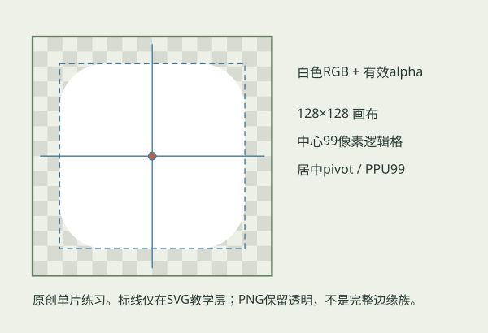

# 地表素材绘制规范与练习

先分清要画的是底纹、边缘alpha，还是独立Sprite。三者负责的东西不同，不需要每次重画一整套地图。本文的SVG/PNG练习图是独立几何技术示意，不含原作像素或规则表，不代表正式美术风格。

**UI_PHYSICAL_UNVERIFIED**　当前真实桌面输入工具不可用，本文没有以示意图替代编辑器主窗口截图或人工制作验收。实际Scene/Game渲染与程序合同需各自查证。

## 1　数字的身份

| 项目 | SOURCE_VERIFIED 源参考事实 | 当前兼容或建议 |
|---|---|---|
| 地层 | 指定Starter七层 | 工坊支持有界槽位；原创样例三层，v1最多16层 |
| 规则与切片 | 源族14条有序规则加默认，15个Sprite | 选已验证边族；原创技术族独立定义，不能只按片数判断 |
| mask | 源128×128、PPU99、居中pivot | 同规格可减少回接变量；其他格式需独立验证 |
| 图集 | 源1024×512、15切片、无旋转打包 | 自有布局可独立设计，Rect/pivot/透明安全区须明确 |
| 逻辑格 | 源组合后4世界单位 | 不为贴图改角色和世界单位 |
| 底纹 | 源材质有数值16的缩放参数，精确公式未知 | 当前16m世界周期为UNITY_ADAPTATION候选 |
| 光照 | 源编译Shader有Lit/Ramp属性 | 当前自有Unlit，不自动获得法线、粗糙度、高度或原作阴影 |

## 2　底纹：画连续内部

下载 [32×32原创技术练习PNG](assets/OriginalTechnical32.png) 后即可走导入流程；[对应3×3平铺PNG](assets/OriginalTechnical32_3x3.png) 是96×96预览，不是另一种画布规格。原文件逐字节保留，Native演练验证受控副本Repeat/sRGB/noMip；15×15无效图被拒绝且没有半成品资产。

底纹画草叶、碎石、泥土、色块和可以平铺的小细节；边缘轮廓交给mask。一个醒目的石头或花团会随整张纹理重复，密度和重复点要在常用游戏镜头下判断。

**交付内容**　保存自有PNG；当前导入向导接受16—4096像素，方形不是强制条件。保留创作原稿，工坊导入受控Repeat副本。没有PSD就不声称交付分层PSD。

**画后检查**　看3×3或更大拼接；看缩小后的明暗和可读性；以世界周期检查实际密度。RGB用于当前地面颜色，底纹alpha不会自动挖洞。方向强烈的木板和笔触不会沿弯路自动转向。

**风格观察与工程规范分开**　透明、采样和周期属于工程兼容；色阶、草叶密度、对比、色相和重复识别点是美术判断。参考的配色不是《星骸回廊》永久风格要求。

## 3　边缘：把轮廓画进alpha

白色RGB不等于遮罩。当前方案用alpha控制轮廓，因此“黑白画面但alpha全不透明”仍会显示矩形。绘制时保留透明背景；直边、凸角、凹角、孤立和窄段要在不同底纹上看。

练习文件 `assets/原创边缘练习_孤岛128.png` 为透明PNG；同名SVG保留可编辑几何形状和说明。它只是单片练习，**不能单独冒充完整边缘族导入**。完整边族应从交付的已验证原创族开始，按其明确邻接语义修改，而不是猜某张图在15片或256片中对应哪一种情况。

**模板标记**　128像素画布，居中pivot；示意的99像素逻辑格位于画布中心，外框余量用于说明越格和安全区，不是额外占地。蓝线/标注只在SVG教学层，透明PNG不夹带这些线。

**族级检查**　孤立、满邻、缺邻、凹凸角、窄段、交叉、道路端点和跨chunk边界；远近各看一次。同一底纹换合法边族、同一边族换两种原创底纹，证明两种职责分离。

**原创技术族的编号**　交付的原创Rounded/Chamfered族使用独立八邻域256个精确状态，所有规则固定方向。打开[完整编号索引SVG](assets/原创技术边缘族_编号图.svg)查看每片的同族/非同族邻格；[编号与Rect表CSV](assets/原创技术边缘族_编号表.csv)记录八个方向、pivot、PPU和Unity左下角Rect。索引图按编号从上往下排，实际图集Rect的y从左下角计，不能照屏幕行数猜坐标。这是本工程原创技术族的明确语义，和原参考14规则/15片并列记录，不互相替代。

**过滤边界**　padding/extrusion取决于过滤和Mip。先复用已验证无Mip路径再测邻片污染，不承诺固定几个像素永远无渗色；不把安全外扩算入逻辑切片改变占地。

## 4　独立Sprite：先确定脚点

独立花草要说明原画布尺寸、pivot/脚点、裁切Rect、trim后的原画布偏移、PPU与世界显示尺寸。图片可见高度和玩法碰撞占地独立。

**Flat**　落叶、小石面或贴地装饰按地面平放。画图中的阴影属于素材本身，不自动变成世界光照。

**UprightYaw**　直立并只绕竖轴适配观察方向，脚点和地面根不动。适合经验证允许这样表现的单面花草；不是所有树石都默认采用。

**FixedUpright**　保持指定直立方向。单面素材的背面和侧面限制必须在八个正常观察角与中间角检查，不自动生成背面。

**允许变体**　缩放限在定义范围内，镜像须明确允许。不要为了随机多样性把一张方向光照很强的图任意旋转，导致手绘阴影与世界方向互相矛盾。

**默认碰撞**　花草不生成玩法碰撞。确有阻挡作用时使用单独明确的配置，不从alpha或颜色猜碰撞。角色仍沿现有连续3D地面移动，不新增Physics2D通道。

## 5　最小自绘回接练习

该组真实相机帧使用192/32/19格基础、覆盖与道路，44个原创装饰保持原位。Native检查预览/取消/提交/Undo和产品磁盘SHA；它不是Editor窗口实拍，也不替代物理输入或审美验收。

1. 画一张可平铺底纹，在工坊导入PNG，选既有已验证原创边族，保存新配方。
2. 在一张有覆盖、道路和手摆花的地图上预检替换当前层已有同类格；确认旧布局与未来笔画一致，取消和Undo可恢复。
3. 将同一底纹换到另一合法原创边族，观察轮廓变化；再用同一边族换另一底纹，观察内部变化。
4. 做2—3张独立花草/地面装饰，逐张确认脚点、trim、PPU、摆放模式和允许缩放；保存成主题组合。
5. 用稳定种子撒布，确认道路避让、手摆/锁定保护。保存并真正关场重开，再进/出Play，位置不重新随机。
6. 仅用原创素材在原创场重复上述流程，确认没有原作图集、规则表、角色私有manifest或本机绝对路径依赖。

技术样本的作用是证明这条接入链成立，不是替用户完成正式商业美术。

## 6　错误对照

| 错误 | 为什么 | 修正位置 |
|---|---|---|
| 遮罩RGB黑白但alpha全不透明 | 当前轮廓读alpha | 图像编辑器透明通道；工坊alpha观察 |
| 用Sprite外框当逻辑格 | 图片可越格，邻接仍按Grid | 边族Rect/PPU/pivot与地图Grid |
| 贴图换了，已有格没变 | 草稿、画笔、提交、保存是不同步骤 | 新配方→已有格预检→提交→保存 |
| 源15片直接套传统47块规则 | 数量不等于邻接语义 | 选择已验证族，不按数量猜映射 |
| 花草变成一面薄片或背面消失 | 单面图视角/摆放策略不合适 | Sprite定义与实际旋转检查 |
| 大图被自动赋同样大碰撞 | 图像和玩法占地混淆 | 保持默认无碰撞，另做明确阻挡配置 |
| 重新撒布改了手摆位置 | 所有权或生成分组处理错误 | 保留实例，记录问题；只作用生成且未锁项 |

## 7　来源与交付边界

图鉴条目的像素、切片、PPU/pivot、源容器、版本、hash和证据身份共同说明素材；同像素不同脚点不能只因内容hash一致而合并。只看到图片像草，不足以判定原作一定Billboard。

源参考图、裁片、派生数据和含参考截图只本机。公开包使用自有代码、原创技术样本和上述独立SVG/PNG讲解图。未知资源可浏览但不能写“已验证可用”；复杂动画的首帧预览也不能写成动画已经接入。
