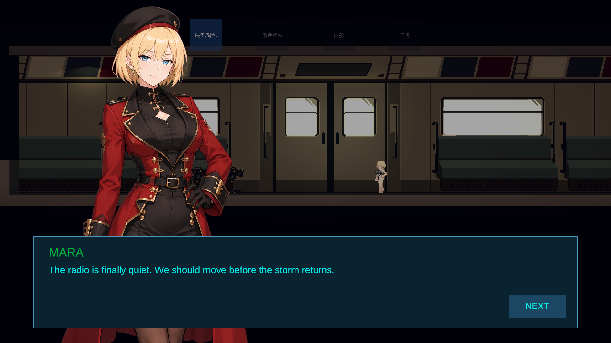
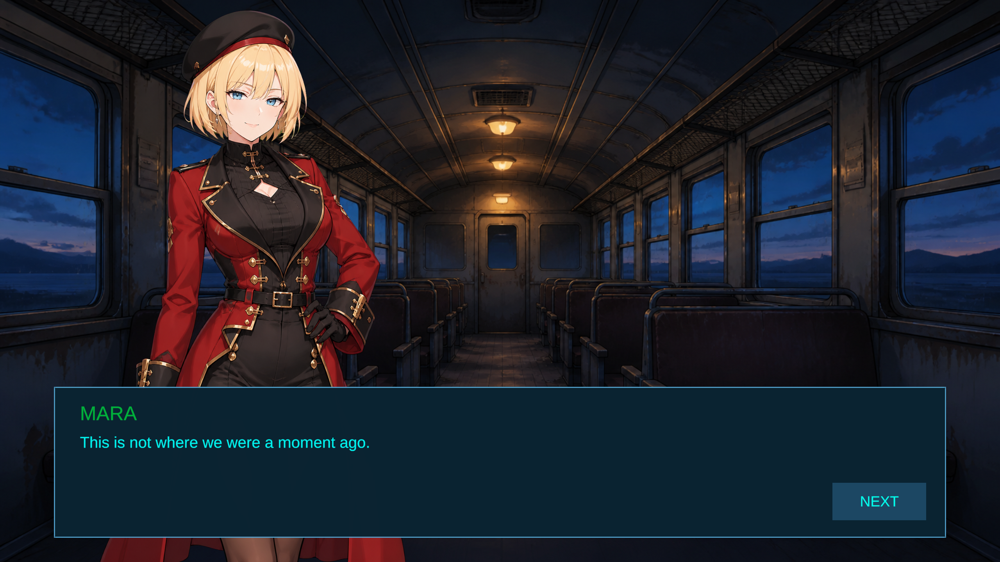

# GalSystem 全屏 AVG 第二阶段验证记录

日期：2026-08-22

引擎：Tuanjie 2022.3.62t12

## 交付结果

本阶段在既有 GalSystem 上增加了 `FullscreenExclusive` 呈现，并保留原有 `PausedOverlay`：

- `P`：打开 Gameplay 背景上的暂停式对话。
- `Shift + P`：打开独立背景的全屏 AVG 对话。
- `NEXT`：推进下一句；第三次确认后退出并恢复 Gameplay。
- 两种模式共用内容播放器、状态机和 GameFlow 仲裁入口，不依赖 Character 控制器。
- 全屏背景支持“行级背景覆盖 > Sequence 默认背景 > 不透明黑色降级”。
- `ConcurrentOverlay` 仍保留为后续 Gameplay 同时运行的轻量对话入口。

## 测试内容

- 二次元临时立绘：`Content/Test/Portraits/SPR_GalPortrait_Test_Anime.png`
- 全屏临时背景：`Content/Test/Backgrounds/BG_GalFullscreen_Test.png`
- 暂停对话：`Content/Test/GalSequence_Test.asset`
- 全屏对话：`Content/Test/GalSequence_Test_Fullscreen.asset`

当前项目没有可用的中文 TMP 字体资产，因此演示对白使用 ASCII 英文，避免缺字方框。正式接入本地化文本前，应给 `TMP_Settings` 或 Gal View 配置包含所需 CJK 字形的字体与 fallback；这不影响本阶段的对话/仲裁架构。

## 自动验证结果

| 检查 | 结果 |
|---|---|
| 团结引擎脚本编译 | PASS，0 error |
| `GalSequencePlayerProbe` | PASS |
| `GalFlowLifecycleProbe` | PASS |
| `GalDialogueViewProbe` | PASS |
| 全屏编辑态组合检查 | PASS |
| `P` 三句、暂停、关闭、恢复 | PASS |
| `Shift+P` 三句、全屏呈现、关闭、恢复 | PASS |
| Gameplay Move 权限阻断与恢复 | PASS |
| `Time.timeScale` 与 Hunt 暂停状态恢复 | PASS |
| 安装器重复运行 | PASS；第二次 `sceneChanged=false`、`sceneSaved=false` |
| 六个受管资源两次安装后的 SHA-256 | 完全一致 |
| 活动场景文件 SHA-256 | 安装前后完全一致 |
| 原 View/Root Prefab local fileID | 全部保留 |

PlayMode 验收器最终日志：

```text
[GalPlayModeVerifier] PASS P PausedOverlay and Shift+P FullscreenExclusive,
pause, presentation, three-line Confirm flow, cleanup and restore.
```

## 实机截图

暂停覆盖模式：



全屏 AVG 模式：



## 场景与资产安全

- 已有 `PF_GalDialogueView` 与 `PF_GalFlowRoot` 使用 `LoadPrefabContents` 原位升级，没有删建核心节点。
- 场景中的 Gal Root 继续保持为 `PF_GalFlowRoot` 的 connected instance。
- 场景只从 Prefab 继承两套测试 Sequence；现有 `gameFlowArbitrator` override 保留。
- 安装器不调用 `SaveScene` 或 `SaveOpenScenes`。
- 本阶段没有修改 Character 控制器源码或引用 Character 模块。
