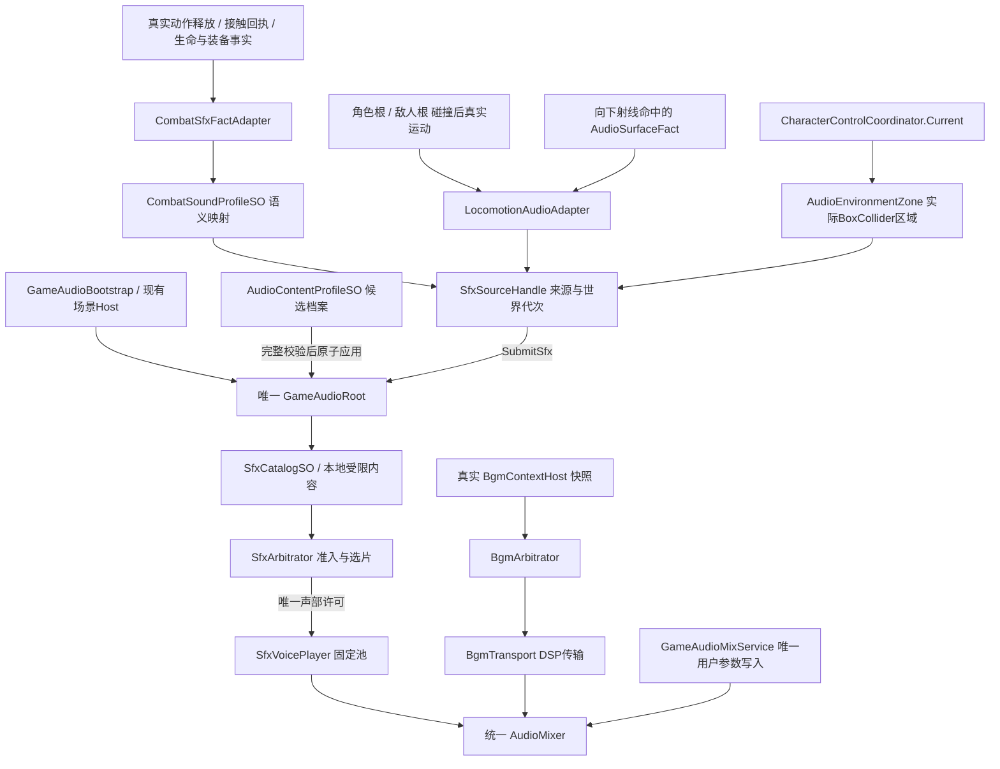

# AUDIO-BB-FUSION：调用链与所有权

日期：2026-10-27。本图描述本轮融合方向和候选接缝；它不是“全部已验收”的声明。运行证据以同任务 `results/` 和 root 交付记录为准。

源码根：`E:/WORLDCREATOR/new/Project_ANKALUTE/Assets/OSSASTRA/Scripts/Audio/`。

## 生产声音路径



## 调用与清理合同

| 发起者 | 允许做什么 | 不允许做什么 | 释放规则 |
|---|---|---|---|
| `CombatSfxFactAdapter` | 观察已接受/释放/真实接触等事实，冻结动作语义，租约提交 | 根据按键预测命中、声音导致伤害、把一整个多段攻击当一条事实吞掉 | 本体失效、生命代次变化、场景失效时解绑/撤租约 |
| `LocomotionAudioAdapter` | 只读本场实体实际运动；距离生成脚步候选；读取真实地表碰撞 | 用按键或单纯时间器发脚步、把闪避/击退/传送算行走 | 不可模拟/不移动/死亡清采样；来源和世界失效撤租约 |
| `AudioSurfaceFact` | 作者明确声明 `surface` 与可选 `impactMaterial` | 从名称/贴图/坐标猜命中材质；写伤害域 | 随真实对象生命周期，不单独建全局状态 |
| `AudioEnvironmentZone` | BoxCollider 包含当前实控位置才启动持续声；平滑淡变；许可丢失后限频重试 | 自建 AudioSource、另建 AudioDirector、抢 BGM 或改天气状态 | 离区淡出停止；禁用/销毁/世界变更立即撤来源 |
| `GameAudioRoot` | 选择有效档案、签发来源、委派准入/播放、持有传输和混音 | 复制角色 Current、决定敌人是否存活、作为第二套战斗结算器 | 唯一所有者；世界边界撤销旧 SFX；同音乐内容按原传输保持连续 |
| `SfxArbitrator` | 校验事实、预算、来源代次、选片、许可 | 创建 AudioSource、改玩法或写作者 SO | 关闭来源/世界撤许可，历史有界 |
| `SfxVoicePlayer` | 验许可，在固定槽播放，更新局部淡变/空间声学 | 绕过许可随意 PlayOneShot、写全局用户音量 | 自然结束/许可丢失/显式停声归槽；复用清理 loop/滤波状态 |
| `GameAudioMixService` | 唯一写用户 Master/BGM/SFX/分组 Mixer 参数 | 把同一个用户增益重复乘到源与组 | 每次设置只由唯一入口应用；开发试听恢复设置 |

## 关键源码接缝

- 基线 `Runtime/GameAudioRoot.cs:175`：目录解析 → `Sfx.Submit` → 持许可 `SfxPlayer.TryPlay` → 有界 observation。准入接受与真正发出播放分开记录。
- 基线 `Core/SfxArbitrator.cs:98`：请求身份包括世界、来源代次、事件和 FactKey；同动作不同子击应使用不同真实 FactKey。
- 基线 `Runtime/BgmTransport.cs:305`：DSP `PlayScheduled`；不是环境 Loop 的普通声部策略。
- 候选 `Runtime/GameAudioRoot.cs`：`TryApplyProfile` / `RestoreBaseline`；先校验，再撤 SFX 来源/世界并替换内容，BGM 按内容身份保持原有连续性。以 root 最终版本和实测为准。
- 候选 `Integration/LocomotionAudioAdapter.cs`：`DistanceFootstepSampler.Advance`、`Eligible`、`ReadSurface`；没有角色控制写入或协程。
- 候选 `Integration/AudioEnvironmentZone.cs`：`Contains`、`StartVoice`、`IsVoiceLive`、`Release`；活动计数来源于许可，不是“曾请求过”的布尔值。

### 已定向验证的生命周期接缝

- `GameAudioRoot.TryApplyProfile` 成功换世界后同步发布 `ContentProfileApplied`；战斗事实适配器重建来源并立即Connect，不等下一LateUpdate才准备接收Accepted。`results/first-action-green.json` 记录首动作接受、释放和声音各1。
- `GameAudioRoot.BindHost` 只接受活动场；`OnActiveAudioScene` 经 `BgmContextHost.AttachAudioRoot` 双向绑定当前Host；`UnbindHost` 清旧引用前释放所属Host的对话scope。Awake完成和OnEnable也执行显式补绑，OnDestroy解除活动场订阅。对应 `additive-host-green.json` 5项与 `late-host-green.json` 4项均为true。
- 接触元数据 `CombatContactBatch.EffectSemantic` 由生产方明确发布，`CombatContactGateway` 保留旧调用的结算路径，`CombatIceWorld` 为实际周期/派生效果提供标识；音频不能只见Periodic就猜冰效果。
- 致死回执仍走正式Died；音频hurt出口只允许HP仍大于0，死亡身份在交接边界冻结。`death-boundary-green.json` 3项为true，事件记录仅 `player.body.death` 已发出播放。

上述是各文件所覆盖的实机边界，不等于完整游戏、未来所有场景或人工听感已验收。

## Lab 仅作为策略参考

参考源码根：`E:/WORLDCREATOR/XingHaiHuiLang/实验工程/BloodborneAudioLab/Assets/BB_AudioLab/Runtime/`。

```text
Lab WorldSemanticEvent
  → WorldCueResolver（纯规则/缺口/证据等级）
  → AudioDirector（语义选片/owner冷却）
  → AudioVoicePool（实验播放）
  → V5TraceExporter（可追溯实验结果）

只借鉴：纯规则、真实多变体、owner环境层、参数化声学、可复验Trace。
不接入：Lab AudioDirector、实验世界模型、Lab音乐传输、暂停体系。
```

## 取证路径

A0/A1/A2/A3 使用同一生产声音路径和真实事实脚本，仅变更档案内容/已审查作者策略/空间混音。开发采集器可以订阅或读取结果，不能绕过战斗事实伪造“试玩已通过”。

最终需分开保存：事实 Trace、许可与 source 状态、真正 Unity DSP 采集及电平、标注 `OFFLINE_PREVIEW` 的任何离线音频、人工试听签收。**源码链可达、声源 isPlaying、离线 WAV 存在，都不等于人工认为好听。**
