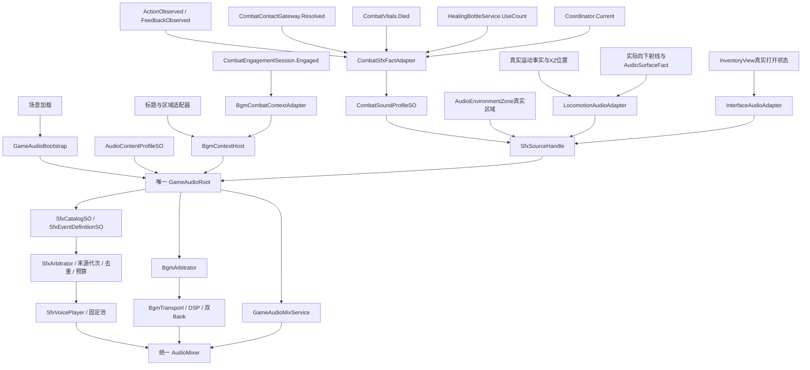

# 当前音频图与事实所有权

2026-10-27。本文件记录本轮源码核对截面，包含正在实施的融合增量；不是已经完成 Unity 验收、可听验收或发布的声明。运行、媒体来源及 A/B 结果应分别以本轮 results 和最终交付报告为准。

## 唯一播放入口



角色根、敌人根、库存与 UI 不拥有本轮新增的 AudioSource。业务只提供既成事实，SO 决定对应内容，根决定是否准入及播放。环境循环仍占用同一声音池，没有另建环境音频管理器。

## 初始化、配置与生命周期

| 入口 | 当前职责 | 证据文件 |
|---|---|---|
| `GameAudioBootstrap.OnSceneLoaded` | 在存在 `CombatFeedbackView` 消费者的场景安装只读适配器；已有根复用；不保存旧场磁盘 | `Assets/OSSASTRA/Scripts/Audio/Runtime/GameAudioBootstrap.cs` |
| `GameAudioRoot.Awake` | 拒绝第二个正式根；组合音乐、仲裁、固定播放器池和统一混音；读取本地内容档案 | `Assets/OSSASTRA/Scripts/Audio/Runtime/GameAudioRoot.cs` |
| `AudioContentProfileSO` | 组合短音目录、战斗语义、音乐规则、世界音频开关、声学开关与随机种子 | `Assets/OSSASTRA/Scripts/Audio/Definitions/AudioContentProfileSO.cs` |
| `GameAudioRoot.TryApplyProfile` | 先验证，成功后撤销旧 SFX 租约/世界，替换内容；不重建 BGM Transport | `GameAudioRoot.cs:183` |
| `GameAudioRoot.RestoreBaseline` | 显式恢复启动时基准档案 | `GameAudioRoot.cs:197` |
| `GameAudioRoot.BeginSfxWorld` | 旧来源失效、停止其短音并更换世界身份；旧事实不能借新代次重放 | `GameAudioRoot.cs:204` |
| `SfxSourceHandle.Dispose` | 仅释放本来源/代次；无权停止其他来源或整个音频根 | `Assets/OSSASTRA/Scripts/Audio/Runtime/SfxSourceHandle.cs` |

`WorldAudioEnabled` 为内容档案开关。新增界面、脚步与区域环境适配器仅在该开关为 true 时工作；A0/A1 保持关闭，A2/A3 由档案启用。具体档案是否引用了正确本地媒体，必须读取原生资产并进行运行验证，不能仅凭此源码图确认。

本地受限媒体及直接引用它们的原生资产不得进入公开仓库。公开源码只描述架构、语义和接线，不等于已经携带 Bloodborne 声音，也不等于恢复了原作 FMOD 运行时。

## 音乐链

1. `BgmCombatContextAdapter` 只转送现有 `session.IsAvailable && session.Engaged`，不另按坐标或距离制造交战。
2. `BgmContextHost` 汇集标题、远区、交战快照；对话是作用域 duck 令牌。当前没有正式对话业务提供方，不应声称完整对话接入已经完成。
3. 根交给原 `BgmArbitrator` 选择目标，再由 `BgmTransport` 管理内容身份、DSP 时间、异步加载代次与切换。
4. 同内容连续性的实际验收，应核对 `CurrentKey / TransportId / Epoch / StartCount`，不能仅凭“仍有音乐”判断。
5. Transport 的两组 Bank 各有三个源，源码报告的音乐源数量为 6；SFX 默认固定池为 32。真实场景总数、唯一 Listener 和声部上限由运行证据确认，不在本表代签。

## 战斗与动作链

`CharacterRoot.ActionObserved`、`EnemyRoot.ActionObserved` 在合法接受时冻结 selector/连段阶段；真实 Released 才触发挥动。能力走 `CharacterAbilities.FeedbackObserved` 的定义、通道、投递方式及执行身份，避免再从 Root 的同一释放重复出声。

`CombatContactGateway.Resolved` 提供同一结算批次的回执。适配器仅在 `Direct` 普通近战接触中选择普通武器命中声；周期与次生接触不自动冒充挥刀。受击与格挡使用真实目标回执。爆炸空落是否出声由明确的能力 `miss` 映射决定，不能把 miss 记为 hit。

新增死亡来自 `CombatVitals.Died`。现源码已经把声音角色 prefix 与原来源租约一并冻结到 pending，Flush 不因同帧换人改写已排队身份。该变更仍需通过实际生命周期合同与玩法回放核对。

接触材质只读取实际 `receipt.Target` 上的 `AudioSurfaceFact.impactMaterial`，通过 SO 的可选 `material` 条件选声。未知材质不推定为 flesh，也不从角色名、贴图或坐标猜测。

## 界面与物件链

`InterfaceAudioAdapter` 只观察同场 `InventoryView.IsOpen / OpenedExternal`，产生以下事件：

```text
ui.inventory.open
ui.inventory.close
interaction.container.open
interaction.container.close
```

首次发现、世界换代、来源重新连接只采样当前状态。容器更换先关闭旧容器，再打开新容器；关闭位置使用旧 ID，打开位置使用新 ID。状态不变的 UI 刷新不发声。关闭背包表面不会销毁根或停止其他来源。

`InventorySession.Changed` 是刷新通知，不是成功事务。成功转移、选中变化、拒绝结果及刷新都可能到达该通知，因此本适配器没有把它当作拾取、消费或装备成功。

`InventoryItemUse.Released` 已存在且发生在真实消费提交后。当前恢复类能力也会发布 `FeedbackObserved("release")`，任何后续同时消费两个入口的接线必须先按同执行 ID 明确声音所有权，不能双播。

## 移动、环境与声学链

- `CharacterMovement` 用碰撞后 XZ 位移报告 `IsMoving / Velocity`；敌人同样报告实际速度。
- `LocomotionAudioAdapter` 以真实运动资格筛选，再累计连续观察到的 XZ 距离；站立、碰墙无位移、死亡、暂停/失焦、闪避、主动机动和受迫位移不应算步。
- 地面材质来自向下射线实际命中的碰撞体标记。没有标记时使用 `generic`，不推定为 stone/wood/metal。
- `AudioEnvironmentZone` 依据明确 BoxCollider 区域和当前实控位置启停一个循环；离开淡出，来源/世界失效立即释放，被抢后节制重试。
- `AudioAcousticObstacle` 声明可遮挡的真实几何。播放器只在档案启用声学且定义为 spatial 时使用声学处理；并非所有 3D 碰撞体都会自动成为音墙。

上述 UI、移动、环境和声学增量的实际回放、循环清理、距离/遮挡效果仍由 root 统一验证，本文件不宣称它们已通过或听感已获用户认可。
