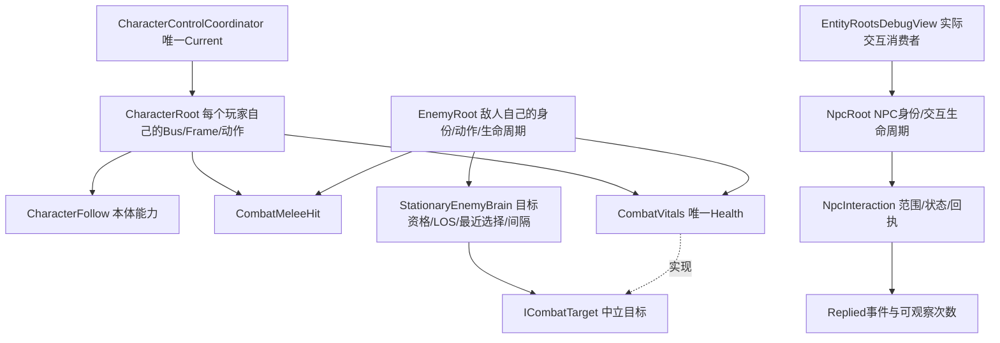

# ARCH-01 三类实体根与共享战斗审查

状态：技术候选通过，用户功能/架构审查待审。基准 b596f9728f2666e2c7d13966fe9f22d45c5297d8。按用户批准 ARCH-01 v1.0 与本机实际源码执行；引用的 ChatGPT 链接返回登录页，未声称读取不可见最新正文。

## 三类根与唯一所有者

三个根没有继承、相互初始化或彼此强制挂载关系。敌人和NPC不进入Coordinator成员表。共享战斗能力是组合关系，未复制三套生命/伤害。原纯Health/BasicActionRuntime/AttackRelease暂留CharacterCore命名空间；实际无Unity玩家Root依赖，本轮不做无关大搬家。

|类型|负责|实际消费者/边界|
|---|---|---|
|CharacterRoot|原唯一输入Frame、Bus、动作、移动/朝向/跟随接线|只把原生命/命中契约切换为中立接口；输入配置和运动算法不改|
|EnemyRoot|actorId、一个BasicActionRuntime、一次Advance/Release、死亡/暂停/失焦取消|没有InputAction、CharacterDataBus、Coordinator、CharacterFollow|
|StationaryEnemyBrain|显式CombatVitals数组、ICombatTarget资格、平面距离、LOS、最近目标、请求间隔|无Update/动作时钟/扣血；Root调用TrySelect/IsEligible，Inspector仍可配置|
|CombatVitals|一个Health、阵营、受击反馈和单次死亡通知|CharacterRoot与EnemyRoot分别显式Initialize；不在Brain/Debug镜像HP|
|CombatMeleeHit|空间候选、目标资格、同ID拒绝、一次Release结算、结果通知|无玩家Root；同接收者多Collider合并，不同接收者同ID整组拒绝|
|NpcRoot / NpcInteraction|独立npcId、有效性、距离与成功回执|无Health/攻击/玩家输入；Debug只能调用公开入口并观察事件|

## 调用与生命周期

敌人：Root.Update → Brain.TrySelect → runtime.Request → Accepted（不扣血）→ 唯一runtime.Advance → Released → CombatMeleeHit.Resolve → AttackRelease.Resolve → 同一个Health → Applied通知/死亡。目标引用与接受时Health引用一并保存；目标退出配置、销毁/禁用、死亡、出圈、遮挡或身份不再匹配则取消。敌人自身死亡、生命组件禁用、Brain禁用、Root禁用、暂停和失焦均撤销未释放动作。已释放的伤害不回滚。

CombatTargetValidity先检查接口宿主是否为仍有效且启用的Unity组件，再读Health；普通假对象、null、Unity销毁后的接口引用均拒绝。源身份不匹配也会关闭Release。中立接口不负责创建第二份Health。

NPC：Development面板.RequestInteraction → NpcRoot.TryInteract → NpcInteraction.TryInteract → Replied → 面板记录真实回执。每次合法调用计一次，不做幂等请求ID或节流；非法距离、禁用、失效来源不增加次数/事件。禁用期间拒绝，重新启用保留状态；销毁时解绑并Dispose。身份和交互状态由该NPC独占，多实例不共用。当前来源有效性由调用者提供，属本机原型边界，不能当作联网权限校验。

## 迁移与保留

采用A路径。旧StationaryMeleeEnemy的脚本资产通过AssetDatabase.MoveAsset迁移为EnemyRoot，固定策略提取到Brain，未保留第二套生产敌人执行器。B1场景经Editor API添加Brain并绑定原A/B目标、保持半径1.7/间隔1.8/伤害20/释放0.5秒；保存重开及真实世界22项通过。B1是授权迁移，**文件已改变**。

CharacterVitals/CharacterMeleeHit迁至Combat/Runtime并中立命名，三份移动脚本的.meta字节和GUID均保留。PlayerCharacter.prefab及meta字节均未改，原8槽接线保持；四早期场和PRE00复验场、InputSettings SHA保持。新场`Assets/OSSASTRA/ARCH01/SC_ARCH01_EntityRoots.unity`使用双玩家、红色敌人胶囊、灰色独立NPC圆柱，无新外部素材。NPC开发按钮在中央面板下方，距NPC2单位内可回应。

本机旧代码仍解禁。旧全局EnemyRoot与新Ossastra.Enemies.EnemyRoot并存，开发面板明确写全限定类型，不能误引旧全局类型。旧解禁asmdef删除仍不提交。

## 集中审查建议

先审[本轮12份变化源码与SHA](ARCH01-source-review.md)：CombatContracts → CombatMeleeHit/CombatVitals → EnemyRoot/StationaryEnemyBrain → NpcRoot/NpcInteraction，再看CharacterRoot小范围接线和Development消费者。实际证据见[验证](ARCH01-verification.md)。每个变更文件全范围重新待审；旧M01/M02A/C/R1/B1账本历史状态保留，不由自动测试代签。

已核实的《灰烬之国》研究只支持敌方AI决策与底层战斗能力可共享、玩家与敌方高层组织不同；其NPC完整根架构仍未知。本实现不是宣称逐行复刻原作。

后续可从NpcInteraction回执扩展真实对话/商店/日程，NPC受伤则可选组合中立战斗能力；本轮均不实施。无寻路/追击/完整敌人AI、正式架势返场、连段或生产NPC玩法。运行期热换身份/成员、动态增删Renderer/Collider缓存不在当前支持范围。停ARCH-01，后续B2/M03需新计划。
