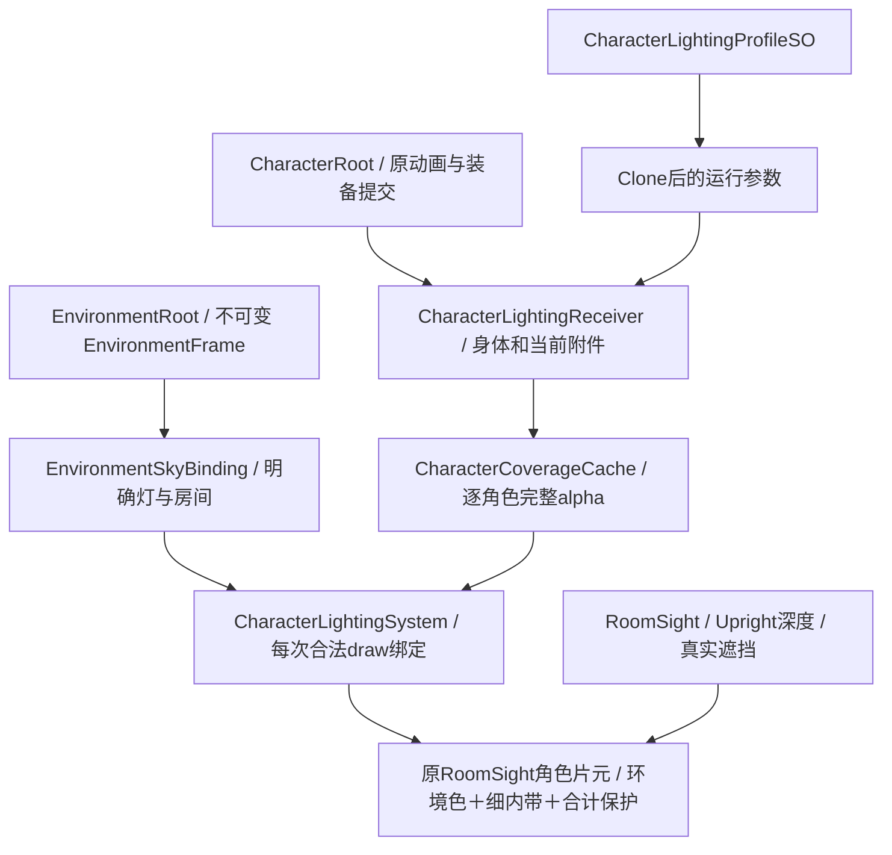

# 角色光感：架构与接入

适用工程：`E:/WORLDCREATOR/new/Project_ANKALUTE`。本轮沿用当前 `SC_RoomVisibilityLab`、EnvironmentRoot、角色根和 RoomSight 正向绘制，不更换渲染管线，不新增每角色 Camera 或 Bloom 后端。

本文说明实际源码职责与接入方法。专项合同已有 Native/GPU GREEN；主场连续操作、真实投影和生命周期收口仍由本轮验证记录分别列出。本文不代替整轮完成声明或用户审美验收。

## 数据从哪里来



`EnvironmentRoot` 仍是环境时间、太阳、底光和天气的唯一来源。`CharacterLightingSystem` 只读这份实际发布给游戏相机的 Frame，不自己推进昼夜、不复制业务状态、不读取最终屏幕颜色给人物染色。一个相机只登记一个角色光感系统。

`CharacterRoot` 初始化可选接收者，在原装备、临时表现和视觉深度提交之后推进成员登记。缓存生成发生在原 `RoomPositivePass` 的实际世界绘制之前，消费当帧 Spine 最终变形网格；没有第二次骨骼求解、动作提交或角色移动。

## 环境色只负责环境贡献

`EnvironmentSkyBinding.ResolveStylizedSkyTint` 仅在手动天空覆盖、同步开关及有效环境 Frame 同时成立时输出艺术联动色。作者色在 C# 中解码一次到 Linear；Shader 不再执行第二次 Gamma→Linear。极暗色、非法输入、未覆盖天空或日照单独对照返回中性零强度。

角色实例还拥有独立的染色开关和强度。因此有效强度为：

```text
天空同步强度 × 当前角色 tintStrength
```

系统诊断显示这个乘积。两个控件都设为0.5时，实际乘积为0.25。它是手动天空的艺术联动，不等同于对天空贴图作物理漫反射积分，也不要求人物和金属球具有相同颜色。

染色只针对明确接收者的角色/装备语义及室外环境贡献。主灯、局部点灯随后保留各自的颜色，不对最终角色 RGB 再乘一层橙色。地表、装饰、信息、技能自发光和原生 Lit 对照不被这一角色开关整体调色。室内归属使用现有明确房间数据，揭顶显示不把室内变成露天。

以下 `.7` 响应、`.12` 保底与后文 `.192` 输出，是本轮早期专项GPU夹具的旧基线，不是当前恢复目标。用户随后选定的现行环境值为：角色最低可读度 `.02`、角色/装备受光响应 `2`、环境底光倍率 `1.99`、室内底光系数 `1`（地表和装饰响应均为 `2`）。旧算法继续消费这些当前参数，不还原M0环境。现有受光算法最终对响应做 `saturate`，因此面板响应值 `2` 在该混合步骤进入的是 `1`；这沿用原算法语义，不表示把最终人物亮度再乘2。

原式按 RGB 分量取最低值，在底光各分量都低于保底时，可能把已经染色的底光完全盖住。本轮早期18时实景已观察到这一情况：低底光约为 `.030/.052/.107`，当时保底为 `.12`，角色仍近似返回中性暗色；因此增加下面的低底光修正。

针对这一实况，`LowAmbientTintGpuContract` 先在旧生产上取得实际 RED，再采用以下最小接线并得到 Native GPU GREEN：先计算旧的合计光与旧分量保底，再只加上环境染色的零亮度色度差，不重新调高全场灯或取消保底。其责任边界为：

```text
旧合计 = max(原ambient + direct + local, 原minimum)
色度差 = TintAmbient(原ambient) - 原ambient
新合计 = 旧合计 + 色度差
```

色度差由同一 Linear Rec.709 亮度归一化得到，直射和局部灯未参与这次改色。非覆盖、染色关闭或强度0时，色度差为0，回到同一当前环境参数下的旧算法 RGB；手动联动时保留原光照增益的线性亮度，允许重新分配其 RGB 色度，不承诺每个通道仍各自不低于旧 `.12`。本轮低底光专项16项已通过：旧RGB约为 `(0.192,0.192,0.192)`，暖色约为 `(0.203,0.191,0.174)`，冷色约为 `(0.187,0.190,0.228)`；三者线性Y均约为0.192。主灯/点灯叠加下色差独立、室内、强度0、禁用和alpha检查均通过，更新后的原环境色合同也通过。这里RGB为显示四舍五入值，精确差值以原回执为准；这是灰色测试原图的低底光夹具结果；彩色原图乘上不同光色后，其最终像素亮度不保证逐像素恒等，不代替所有曝光与实际美术条件。

## 完整轮廓不等于最终可见轮廓

`CharacterCoverageCache` 将同一角色的身体与当前装备合并到一个 alpha 槽，两个角色使用相互隔离的槽。缓存读取真实源图 alpha、当帧网格/slot alpha、材质透明度与当前有效面；不使用墙或黑幕截断之后的画面作为人物形状。

因此，墙挡住腰部产生的新截线不是肩部或衣服边缘。最终颜色仍在原 RoomSight 许可、原 ZTest 与 Upright 深度成立的角色片元里计算，缓存本身不绘进主画面、不给墙后人物授权。片元未获许可时，本体和轮廓一起被拒绝。

`CharacterLightingSurface` 只求有限邻域内带。邻域必须确有接近透明背景的样本，才有外缘资格；半透明零件从0.5叠到0.75产生的内部变化不直接算轮廓。外扩宽度为0，没有逐附件各画一圈或额外 Additive 人物合成。原像素 alpha 不扩大。

`CharacterLightingRim` 把灯方向投影到当前相机平面，比较完整轮廓的屏幕外向方向。近零投影明确返回0，无有效灯时轮廓增益为0；夜间保底不是轮廓灯。颜色来自实际主灯或合格点灯，未写死白色。这是二维人物的方向性形状提亮，不是肩、头发、金属与布料的真实三维法线或 BRDF。

## 遮光与点灯近似

主灯轮廓复用当前 URP 真实主灯阴影和环境云直射衰减。屋顶颜色隐藏仍须保留原 Caster；本模块不删除顶盖遮光、不通过额外全场灯补偿。

局部轮廓灯只从 `EnvironmentSkyBinding.localLights` 的明确列表选择，不逐帧搜索全场 Light。当前每角色选一盏 Point 灯，检查有效性、距离、房间以及中心/上下共三条线段与已登记 OBB 的交叉。已选灯有15%权重滞回，换灯先减弱再增强；灯失效、异室或被拒绝后撤销其贡献。

这三线段是**整角色的保守遮光资格近似**，不是逐像素附加灯阴影。四肢、武器超出采样位置、跨窗或贴墙时仍需真实姿态负例；未登记任意 Mesh 也不能被文字说明成已经支持。主控能否看到灯、房间是否探索，均不替代这些物理遮光判断。

## 高亮保护处理合计增益

原主体受光先得到不包含贴图和 slot alpha 的光照增益。轮廓有独立预算；主体很亮时额外预算缩小。主体与轮廓相加后，再进入按统一 RGB 比例缩放的亮度软肩，最后乘原图颜色。

低于拐点的正常段保持不变，强光段逐渐收敛，没有对 RGB 各通道硬截白。软肩限制的是光照增益的亮度，不能据此声称任意 HDR 原图的最终像素都低于某个固定分量值。本轮对象是当前选中的 LDR 手绘角色，未扩展到全 PBR 材质或所有特效。

非线性作用于独立增益，因此同一受光下不透明像素与半透明发梢使用同一映射；不对预乘后的 RGB 直接套另一阈值，也不盲目反预乘。Spine 的 StraightAlpha 输入关键字、PMA 混合，DepthPlane 已有输入转换、alpha cutoff 和原深度分支保持。Spine 中 alpha接近0但 RGB 非零的加色业务附件走原受光路径，不参加新增轮廓或保护。

当前用户批准并已写入作者Profile及新建类型缺省的参数为：`tintStrength=1`、`rimStrength=.28`、内带 `4` 最终像素、柔度 `1.23`；轮廓预算 `.35`、`knee=1.2`、`ceiling=2` 保持。早期内带1.5等数值只作为历史候选，不再作为默认恢复值。颜色/保护参数属于本项目的线性增益，内带宽度属于最终画面像素；它们不是通用物理灯强或最终sRGB上限。后续调参由用户继续判断，基础验收不依赖 Bloom。

## 身体、装备与特效的接入

| 内容 | 接入责任 |
| --- | --- |
| 身体 | 接收者的 `bodyRenderers` 明确填写实际颜色 Renderer，不填深度/阴影代理。原五方向由原表现系统选择，缓存只消费当前网格。 |
| 左右手 Spine 装备 | 接收者读取已有 `CharacterEquipmentSpineView` 只读表现端口；更换实例后更新成员，不另建装备状态机。 |
| 现有 Sprite 装备 | 从已有 `CharacterEquipmentView.PresentedRenderer` 接入，沿原生命周期。 |
| 其他身体附件 | 使用 `RegisterAccessory` / `UnregisterAccessory`；附件必须仍属于该角色，脱手或移出层级后不能继续借旧人物身份。 |
| 血条、伤害数字、技能特效与代理体 | 不登记为身体。alpha0加色不是人物轮廓；原自发光业务语义排除。 |

当前缓存支持 MeshRenderer 与受限的 Simple、无 SpriteMask 的 SpriteRenderer；超出已支持家族不能默认签为兼容。主场保留源材质身份，适配材质由既有正向绘制后端持有；新接收者不争写 `sharedMaterial`、PropertyBlock 或 `Renderer.enabled`。正式角色使用现有 DepthPlane/Spine 适配入口，原生 Spine Lit 作为显式对照保留，不批量改全项目材质。

以后换原创角色时，先确认已有实际动作、五方向、输入 alpha 与装备表现正常，再登记身体和当前附件、明确游戏相机、分配 Profile。无附加法线也能使用本轮基础轮廓；若以后增加高光响应遮罩或法线，应作为可选作者数据接入，不能改原 alpha 打包来掩盖错误。

## 配置与三个关闭路径

`CharacterLightingProfileSO` 只存作者设定；`CharacterLightingReceiver.Settings` 首次访问时 Clone，面板改运行副本。设置整个 `Settings` 也会 Clone；`Sanitize` 将 NaN/Infinity 恢复为有限缺省、限制范围并保证软肩上限大于拐点。运行调节不会偷偷回写共享 SO。保存候选是明确作者操作，另建独立 Profile。

- 关闭环境染色或将其强度设为0：天空艺术色差归零；已有自然环境受光、局部灯和保底继续。
- 关闭轮廓或将其强度设为0：无新增轮廓增益；没有任何接收者需要轮廓时释放自有覆盖缓存。
- 关闭高亮保护：跳过新增软肩，保留当前主体/轮廓增益；三效果都关时回到当前用户选定环境参数下的旧角色受光算法。

系统总开关、接收者失活和无效相机/环境发布租约也会停止新增效果。窗口按钮名为“旧效果”，它只关闭三个新增功能；保留当前用户环境参数，不还原M0环境，也不等同于关闭 ENV-01、换成原生 Spine 材质或暂停游戏。

## 缓存预算与释放

每个有效游戏相机的正向 Pass 持有一张 `1024×512 RGBA8` RT，左右两个512²槽，共2 MiB颜色存储，无深度、MSAA或mipmap，另有一个覆盖材质。单次最多2名角色、每人8个明确 Renderer、每 Renderer 16个材质槽；超预算保守关闭该帧轮廓并诊断，不把角色身份随机塞进别人的槽。

覆盖 draw 数随当前身体与装备的有效子网格变化，理论上限由上述预算约束。当前主场实际回读为2名角色、5次覆盖 draw、2 MiB；这不是零成本结论。它还增加缓存清除、采样和参数绑定，GPU耗时仍须以实际测量记录，不能从显存大小推导固定FPS。没有逐帧 CPU 纹理读回、每角色 Camera、重新打包 Spine 图集或逐帧创建材质。

`RoomPositivePass` 订阅 `CoverageInvalidated`，根/相机更换、环境登记释放或模块禁用时撤销缓存；正常 Pass Dispose 也退订并释放。`CharacterLightingSystem.TryGet` 检查真实游戏相机、环境两个组件有效、EnvironmentCameraRegistry 当前 Frame 与 Root.Current 同一对象，拒绝禁用后残留的历史快照。失效/移除接收者的选灯记录会清除。每相机开头/结尾及逐对象绑定先清新增开关，SceneView 或其他相机不借上一名角色的参数。

这些是代码释放机制。3次启停、真实销毁/切场及保存重开的最终结果仍应查看验证回执；源码有释放分支不自动等于所有生命周期场景已实测通过。

## 已有证据与仍需区分的结论

Root 已报告的专项 GREEN 包括：环境贡献染色、低底光16项、正式 Spine/DepthPlane 四种 alpha 输入组合的增益保护、8灯/加色边界、Settings 校验与克隆、17项完整覆盖、12项内带形状，以及两份实际 UI 合同。真实覆盖缓存＋正式Spine方向合同中，左右对应边增益均约0.29805、错误侧为0，未知区域全零、截线不提亮、近零投影不产生轮廓均通过。主场2角色/5覆盖 draw/2 MiB已实际回读。

低底光吞色是较亮夹具通过后发现的实景问题，已有独立 RED→GREEN，不能丢弃该失败历史。真实五面/装备运动、转镜头、贴墙/窗口、连续录像、资源启停和保存重开的收口，以本轮最终验证文件为准。Player、其他图形 API、任意 Mesh 遮光与用户最终美术满意度未由本文代签。
