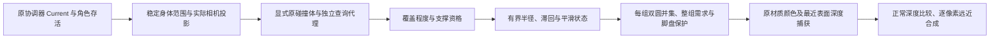

# KT-VIS-01 模型遮挡透视

本文说明当前接入方式；完成状态与实测边界见 [validation.md](validation.md)。独立场景只保存在本机，不包含在源码发布中。

## 入口

- Unity 菜单：`OSSASTRA → 场景可见性 → 打开独立遮挡验证场`。
- 本机场景：`Assets/OSSASTRA/GroundWorkshop/Samples/KT-VIS-01/SC_OcclusionVisibilityLab.unity`。
- 场景根：`KT_VIS_01_模型遮挡透视`。Inspector 的 `SceneVisibilityRoot` 显式登记原相机、原控制协调器、两个保护目标与有限环境组。
- 运行时右上角可切换环境透视、仅检测和伙伴保护；右下角提供合法站位路线及恢复入口。世界持续运行。角色深度修复是独立可选组件，关闭环境透视仍保留墙边修复。
- 配置资产：`Assets/OSSASTRA/GroundWorkshop/Samples/KT-VIS-01/VisibilitySettings.asset`。运行时使用启用时的配置快照；更改后在根 Inspector 点“应用配置并重接本模块”。

原因、逐像素证据和修复取舍见 [diagnosis-and-fix.md](diagnosis-and-fix.md)。

## 两类切身的区别

墙前案例的胶囊碰撞体在实体墙外，倾斜朝向镜头的角色显示网格却伸进了墙。可选 `CharacterUprightDepth` 保留角色屏幕位置、UV、颜色、透明度与骨架动画，为每个像素按脚点所在的竖直平面求环境深度，并保留原片层的眼深度差。它由原 `CharacterRoot` 组织初始化、装备表现后的准备和释放，旧场没有组件时保持旧行为。

另一个案例的角色与显示网格都在低地合法位置，前景高台顶盖遮住下身。这是正常遮挡，交给环境模型透视处理。关闭透视时仍应保留这种深度关系。

装备与身体共享同一深度契约。Spine 保持原颜色 pass；不透明装备像素另用自有、只写深度的辅助绘制，防止透明羽化墙染到前方装备。遗留 Sprite 装备通过只读表现端口接入对应材质变体，不改装备状态或技能逻辑。

## 运行链

检测不读取已淡出的颜色或深度。装饰的查询 Box 位于本模块自有的独立 Physics3D Scene，不进入主场的攻击或碰撞查询。透明不会停用原 Collider，也不会改变行走、索敌、伤害或音声逻辑。

同一模型的墙、顶盖和已登记附件统一捕获，避免每片地表各叠一层透明。多个模型按每像素真实深度排序；两名角色的圆窗需求取最大值，不互相覆盖或连乘。

## 接入新的环境模型

1. 建立 `SceneOccluderGroup`，填写明确的显示成员和未淡出的检测 Collider。不要登记整个世界根。
2. 高台填写 `platform`，由现有 Binding 取得当前顶盖与缓存。保存或重建会替换顶盖对象，不能手工把旧顶盖实例钉在数组里。
3. 高台的装饰按该 Map 的重建版本重新登记。独立装饰也可显式加入显示成员；只在来源变化时更新登记，不逐帧扫描全场。
4. 只有有限小模型才开启整件淡出。大地形默认只允许局部开窗；`minimumOpacity` 可保留最低不透明度。
5. 保护目标填写明确角色和身体高宽。不要使用武器、特效或隐藏方向分支的 Renderer bounds 推导整个人物范围。
6. 将组与目标加入 `SceneVisibilityRoot`，检查登记，再用合法前侧、后侧、站台、切人和退出路线验证。

## 参数与边界

默认预算为两个目标、四个活跃模型组、每个目标五个稳定检测点；检测约 20 Hz，实际相机投影与平滑逐帧推进。预算超额有明确诊断，优先保留主控需求。半径由遮挡程度决定，静止不会无限增长。

主控站在高台上时，整块承载顶盖保留，只处理前景成员；伙伴可能仍被保留的顶盖合法遮住。伙伴站台而主控在低地时，保留伙伴脚下的小盘，同时允许主控局部透视。整件淡出在支撑冲突时禁止。

当前材质适配范围是已验证的 URP/Lit、地表 ThinTop 和原创 DecorationCutout 的 Simple Sprite；未知材质、任意半透明环境、Sliced/Tiled Sprite 均应拒绝并保留原图。角色 PMA 材质另由角色视觉深度模块管理。

当前渲染范围为指定 Gameplay Camera、标准透视或正交投影、完整 viewport、URP renderScale 1、Default 排序层、无 SortingGroup、当前无阴影/无 SSAO/无自定义 RendererFeature 的样板配置。偏移投影、XR、任意后处理或管线升级需另验。普通 SceneView/结构观察旁路；嵌套手动相机渲染不属于默认合同。

## 资源与发布

所有自有材质、Mesh、RT、回调和查询 Scene 均按实例持有并条件归还，不改共享原材质。运行状态不应保存进资产。

源码与技术文档可定向发布；角色、商用参考素材、派生 UV 缓存、场景和真实画面证据保留本机。本轮编译与验证针对本机当前工作树；用户原有未提交修改保留在本地，未合并进本轮发布，也未认证缺少私有依赖的干净仓库构建。性能数据只记录实测 CPU/资源与可取得的渲染计数，未取得的 GPU 时间不会写成零或由 Editor 计时推断。
