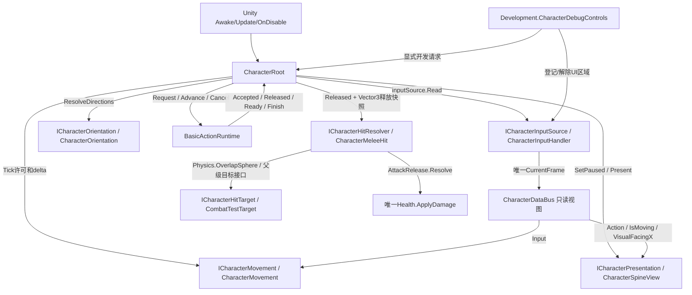

# M01-R1 v0.5 当前候选审查入口

状态：CANDIDATE / UNDER_USER_REVIEW。用户当前指令批准实施v0.5；没有批准架构定稿、M02或本轮GitHub推送。
基准：main@6fdd36ad2b90d7bb948c0be8df6c50649f331265。本轮只修R17、R18和必要连锁影响。

## 实际实现与取舍

**R17**：CharacterOrientation唯一写AttackDirection与VisualFacingX，两个状态用途明确。可移动的A/D输入决定显示翻转，W/S或停止保留左右朝向；鼠标瞄准不会在跑步时强制覆盖左右显示。Accepted与Released事实当帧FaceAttackDirection。移动许可重新开放后按移动输入显示；释放当帧的攻击显示有优先权，次帧可恢复移动显示。

**攻击候选优先级**：合法鼠标XZ方向 > 手柄右摇杆 > 当前移动向量 > 上一次合法AttackDirection。鼠标屏幕坐标须在窗口内、不是登记UI区域/UGUI、可投射到角色XZ平面且方向非零。界外/UI指针不参与方向，鼠标点击也不发攻击；手柄攻击不因闲置鼠标在UI内而被屏蔽。停放在合法位置的鼠标仍优先于手柄，这是明确候选取舍，不伪称用户已经指定；如需活动设备切换优先，审查时可改。

**采样时机**：延续释放帧采样。先本帧采样/方向解析，再推进单一BasicActionRuntime；Released时复制一个Vector3 releaseDirection传入ICharacterHitResolver，批次内固定该值。不是接受时锁定方向：攻击准备期间改指向会改变本次出手。这已由左右实体靶HP验证。

**R18/C1**：Inspector继续存具体组件字段；Awake按明确赋值取得ICharacterInputSource/ICharacterMovement/ICharacterOrientation/ICharacterPresentation/ICharacterHitResolver。Root实际帧调用与DataBus实际读取均走接口，不靠全局扫描。旧参考Root的ICharacterSubsystem.Initialize(Root)/ICharacterTickable.ManagedUpdate说明了用户熟悉的初始化/显式次序；本轮只复用理念，不依赖旧程序集，也不把阶段各异的动作硬塞统一Update。

仅Movement与Presentation实现ICharacterSubsystem.Initialize(DataBus)，Root按movement→presentation顺序逐个初始化，失败立即停止并禁用Root。Input和Orientation无需假初始化；HitResolver接收完整释放参数，也不再为了统一而保存无用途DataBus。

**开发依赖**：CharacterDebugControls位于Development，承载原OnGUI/F1–F4/开发靶引用，使用Root通用CancelAction/SetPaused/SetAttackRestriction及同角色运动/朝向组件。OnDisable解除自身owner限制和输入阻挡区域。Root不再引用Development。CharacterMeleeHit通过ICharacterHitTarget从Collider父级显式找目标适配，不再引用CombatTestTarget；原开发靶实现接口，Health依然唯一扣血权威，无新敌人/HP系统。

## 真实通信图

具体函数行号以[全量源码与逐块说明](M01-R1-source-review.md)和[source manifest](M01-R1-source-manifest.json)为准，以上每条边对应实际同步方法，无新增C#广播/UnityEvent/协程。

## 状态与生命周期权威

| 状态 | 唯一写者 | 读取与退出 |
|---|---|---|
| 输入帧/按键状态 | InputHandler/InputAction | Bus返回struct拷贝；OnDisable清空，OnDestroy释放动作 |
| VisualFacingX/AttackDirection | Orientation | Bus与释放快照只读；无静态共享 |
| 位置/实际速度 | Movement/CharacterController | Bus读取；Teleport清速度 |
| 身份/动作时钟/释放/Ready/取消 | BasicActionRuntime | Root调用领域方法，Bus只读；禁用/失焦具名取消 |
| owner控制限制 | ControlAuthority | Root通用入口；Development禁用仅解除自身owner |
| HP | Health | ICharacterHitTarget提供同一Health，Release去重后唯一结算 |
| Spine clip/ScaleX/timeScale | SpineView | 不写HP、不释放动作；暂停/禁用恢复原速度 |
| 模块引用 | Root Awake | Inspector具体槽→接口赋值；OnDestroy清接口/Bus/Runtime引用 |

DataBus持有原所有者接口，读取实时结果，不复制第二份可写HP/动作时钟。Root只在需要时创建本角色实例，场景销毁后没有静态容器保留引用。

## Inspector与资产

PlayerCharacter.prefab：Root的input/movement/orientation/view/melee全有；相机可由场景override或Camera.main绑定。DataBus是运行时纯C#对象，不是另一个Inspector组件槽。Development调试适配character引用本角色，target只由M01场景override到M01_Target_0。

验证场SC_M01_CharacterTest.unity仍是自有验证场，使用用户rozeul与target 1引用，不改Spine数据、地块、导入比例或URP。旧代码保持用户要求的解禁状态。公开仓库仍不是可分发完整Unity工程。

## 验证与未完成项

验证命令、版本指纹和最终结果见M01-R1-verification.md。所有源码范围保持待用户审查，手工物理键鼠体验待用户完成。任何候选优先级/命名/接口都可由用户推翻，修改后重审受影响范围。

下一步仅逐行审查，不自动决定M02。没有完整角色HP/死亡、队友AI、连段、技能、装备或全局事件总线。当前Development GUI是开发工具而非正式游戏UI。
