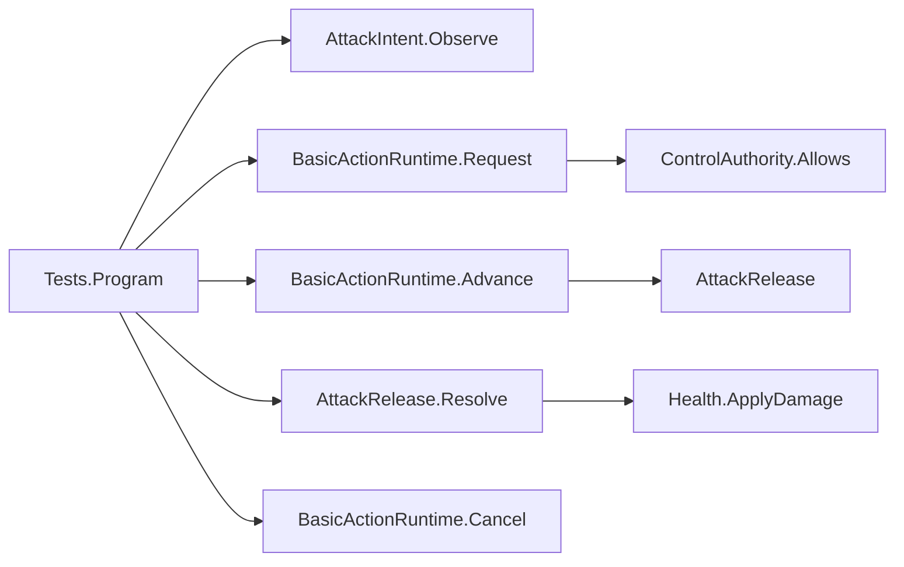

> 历史M01候选文档。2026-10-19共享脚本命名、路径和输入接线已修整；当前以 [修整报告](character-control-refinement.md) 和 [用户规则](../../OSSASTRA_RULES.md) 为准。旧逐行解释不代表新版本已审。

# M01 核心实际权威与调用关系

范围：仅Candidates/M01中的纯C#候选。没有MonoBehaviour、Root、UnityEvent、静态广播、单例、Spine适配器或Inspector接线；这些不存在的脚本不能记为已完成。

| 实际文件／类型 | 唯一写入 | 读取／直接调用 | 生命周期与限制 |
|---|---|---|---|
| ControlAuthority.cs：ControlChannel、ControlAuthority | owner→禁令字典 | 调用方Block/Release；Runtime.Request读取Allows(Attack) | owner按引用身份；只释放自己，不提供全局Clear |
| AttackIntent.cs：AttackIntent | Held历史、armed | 调用方提供设备Held，Observe仅返回按下边沿 | 失焦/禁用适配器以后必须调用SuppressUntilRelease；目前没有接Unity事件 |
| BasicAttackDefinition.cs | 构造时验证后只读节点/正伤害 | Runtime读取 | 无默认平衡值；测试样本不是正式角色参数 |
| BasicActionRuntime.cs：ActionFact、ActionRequestResult、BasicActionRuntime | 当前动作身份、时钟、节点游标、两Ready和唯一终结 | Request读取权限/暂停；Advance产生释放凭据；Cancel具名关闭 | 无日志开关和静态计数；Guid在接受时分配；事实直接返回，没有订阅/解绑遗漏 |
| AttackRelease.cs：HitReason、HitOutcome、AttackRelease | 单次释放是否已结算、当前批次目标身份去重 | Resolve直接调用Health.ApplyDamage | 一个释放只结算一个批次；空批次关闭；构造internal，外部不能凭空创建释放；已返回效果不因身体取消撤销 |
| Health.cs：Health | 唯一真实Current HP | 仅同程序集的释放结算调用内部ApplyDamage；外部只读 | 正整数伤害、HP下限0；场景Adapter以后必须引用同一个Health，不能另建真实HP |
| Tests/Program.cs | 测试计数与测试夹具 | 通过上述公开接口操作真实类 | 退出码0是所有断言通过；没有模拟Spine或宣称物理检测 |

## 当前可执行调用链

这是实际测试调用，不是虚构已存在的Unity Root。所有通信都是直接调用、返回对象；C#event/UnityEvent/静态事件数量均0。没有要在OnDisable退订的隐藏连接。

## 调用合同中容易误读的点
- Request结果Accepted只代表正式接受，不等于Release，更不等于命中。拒绝有paused/attack-blocked/busy原因且不创建动作身份。
- MoveReady与AttackReady是动作自身的许可，不覆盖控制限制。以后Root必须把MoveReady与Move通道、暂停等资格组合使用，不能把此属性当全局canAct。
- AttackReady允许新的真实按下。新请求替换仍在恢复尾部的旧动作时，返回PreviousTerminal（Cancel，原因replaced-by-next-attack）和新Accepted。调用方须先处理PreviousTerminal；这不是暗加连招或缓冲。没有新按下则旧动作到Finish自然终结。
- Advance的delta必须有限且非负。大delta按节点时间发事实；At是动作局部节点时刻，不是过帧后的晚到时刻；补偿累计处理60Hz浮点边界。暂停时不消耗动作时间。
- 取消前Release未到就没有效果；已返回的AttackRelease代表已提交效果，可在身体取消后结算一次，不会回滚。Resolve不能重复开启，也不能利用空挥长期保留开放窗口。
- Resolve只处理调用方已筛选的Health候选，未实现范围、阵营、视线、碰撞层或实际Collider查询。目标Id须在一个世界中唯一且稳定；同一身份的多个Collider不重复伤害。
- 暂停权威由未来调用方提供给Request和Advance，失焦/禁用由未来生命周期Adapter调用Cancel与SuppressUntilRelease；目前只验证这些方法组合的合同，没有验证Unity系统事件实际进入它们。

## 场景接入更新
用户已授权用target 1铺地，当前独立M01场景及实际调用链见M01-scene-review.md。核心职责仍不承担Unity空间查询；这些由M01Motor/M01MeleeHit等明确适配器实现。物理键鼠体验、用户逐行架构审查与发布批准仍待进行。
