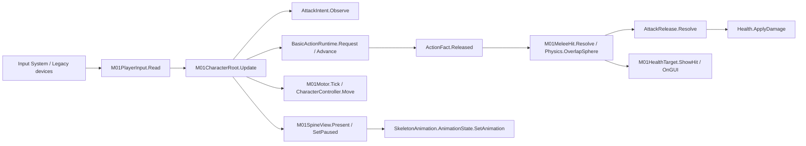

# M01 场景候选：试玩与审查入口

状态：CANDIDATE / UNDER_USER_REVIEW。2026-10-19用户明确授权推送此候选供Chat查阅；该授权不代表手感、动画观感或逐行架构审查通过。最新接手状态及场景快照差异见M01-HANDOFF.md。

## 直接试玩
当前已打开Assets/OSSASTRA/M01/SC_M01_CharacterTest.unity，退出Play后保持Edit ready/clean。点击Unity Play，再点击Game View使其获焦。
- WASD／方向键：XZ水平地面移动。
- 鼠标指向地面，左键按下一次：单段atk1；持续按住不自动重复。
- X：具名取消；P：暂停／继续（动作、移动与Spine同步）。
- F1或左上按钮：恢复target-a并站到合法攻击距离。
- F2：按owner切换禁攻；F3：取消／解除测试禁攻／恢复靶；F4：输出真实状态。每个按钮说明了所操作的领域状态，非改UI假成功。
- 测试靶显示实际Health HP，受击闪白、零血变灰；临时伤害12。正式平衡未定稿。

## 场景与素材边界
用户指定target 1是4x4体素标准地块。实际模板Assets/随便尝试/target 1.fbx，保留实例Scale100和原旋转，世界尺寸1×1×0.25。独立铺12×10=120块，另有4个无形边界Collider。
用户rozeul的SkeletonDataAsset.scale现为0.001，模型实例Scale1；沿用其当前idle1_1／run／atk1，不修改原Spine资产或体素比例。
源场Assets/OSSASTRA/Scenes/SC_PRE00_Empty.unity、target 1.fbx、rozeul_SkeletonData.asset三项前后SHA均一致。新场只加入自有相机、DirectionalLight、Controller、测试靶和接线；没有保存/覆盖源场，也没有改全局URP配置。
新场127个Collider（120地块+4边界+1Controller+2靶），6个根对象。测试靶胶囊仅是靶，不冒充Spine角色验证。

## 实际脚本及Inspector接线
| 场景对象 | 实际脚本／字段 | 引用／状态权威 |
|---|---|---|
| M01_Player | M01CharacterRoot.motor | 同对象M01Motor |
| M01_Player | M01CharacterRoot.view | M01_Player/M01_Spine_rozeul上的M01SpineView |
| M01_Player | M01CharacterRoot.melee | 同对象M01MeleeHit |
| M01_Player | M01CharacterRoot.viewCamera | M01_Camera |
| M01_Player | M01CharacterRoot.debugTarget | M01_Target_0上的M01HealthTarget |
| M01_Player/M01_Spine_rozeul | M01SpineView.skeleton | 同对象SkeletonAnimation；SkeletonData为用户rozeul |
| M01_Player | CharacterController | 高1.5、半径.22、中心Y.75、skin .02；脚底支点在地面附近 |
| M01_Target_0/TargetBody、M01_Target_1/TargetBody | CapsuleCollider／Renderer | 父对象M01HealthTarget各持唯一Health，target-a、target-b |

M01CharacterRoot Inspector暴露releaseAt=.3、moveReadyAt=.5、attackReadyAt=.8、finishAt=1.1、damage=12；M01Motor暴露speed=3、groundStick=2；M01MeleeHit暴露reach=.8、radius=.65、height=.8、LayerMask。修改配置后重新进Play初始化；这些值是明确临时值，不冒充游戏定稿。

内部全部直接调用和返回事实，无全局事件总线、UnityEvent或静态广播。Root负责顺序和生命周期，不另写时钟、HP或Spine的释放回调。Spine没有伤害/正式Finish回调权威。

## 验证结果与界限
- Unity编译成功，独立Ossastra.CharacterCore程序集真实Player sourceFiles恰6份，旧目录Player源0；核心29项合同测试仍通过。
- 场景14项最终全部通过：输入→atk1→100→88、Held不重复、释放前取消、释放后保留命中、owner禁攻、空挥、领域暂停、Spine暂停、恢复单次释放、失焦Held不重启、禁用/启用Held不重启、移动run、停步idle、真实HP归零。
- 自动化采用临时InputSystem测试键鼠、队列事件、Game View焦点和显式生命周期回调注入；不是物理键鼠或用户手感验收。测试后的自有设备数0，onAfterUpdate/update回调已解绑。
- 真正产品缺陷RED→GREEN：原暂停只停领域时钟，Spine TrackTime仍增长；本轮SetPaused同步原始timeScale后实测冻结并恢复。原始失败回执保留。
- 第一轮场景fixture曾受编辑器输入焦点/current设备竞争影响，后用自有测试设备固定current；第二轮fixture两处断言误要求player-cancel、禁攻后未先松键，均保留失败原件并修正夹具。最终14/14，不把早期失败涂抹或冒充产品全绿。
- MCP鼠标点击工具曾仅发OnMouseDown而未经过本角色输入链，不把该成功回执当作伤害证据。Spine4.3探针旧GetCurrent调用失败，改用当前GetTrack；仅探针错误，不是项目编译错误。
- 旧备用Renderer仍报missing RendererFeatures的已知OnValidate错误；本轮未修改它。没有独立Player构建、低端性能认证或多人/AI/技能验证。

## 用户审查账本
所有12份生产C#及测试程序均为待审。精确路径/行数/SHA在外部scripts-manifest.json；完整源码、逐行解释草稿与新增Diff在本轮审查包。候选名和拆分均可由用户修改；更改后受影响区间重新复审。自动测试不等于架构批准或发布批准。
建议先体验，再从M01CharacterRoot→M01PlayerInput→核心Request/Advance→Motor/Spine→MeleeHit/Health逐行审查。
