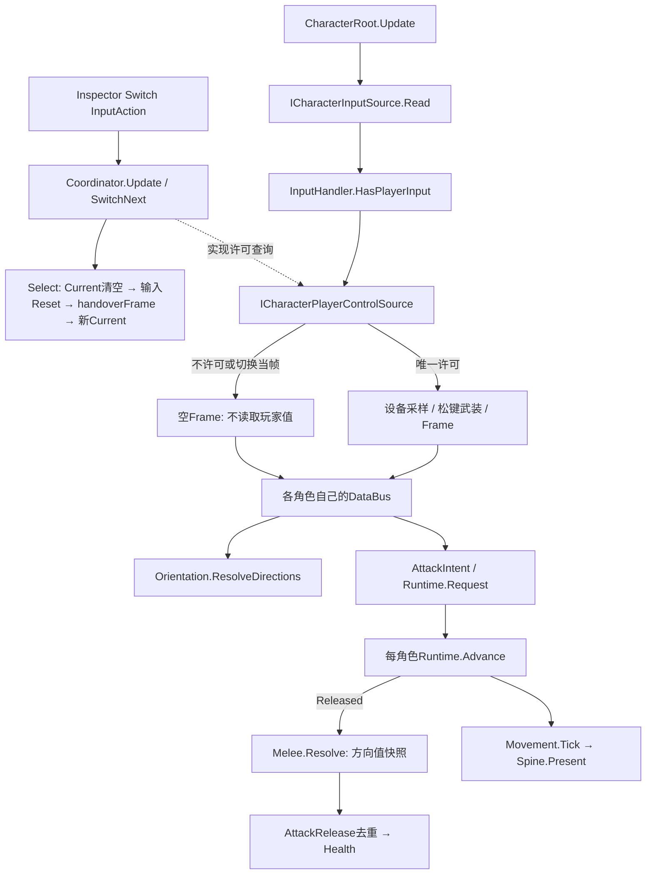

# M02-A 双角色控制候选｜审查与交接

2026-10-19，候选待用户逐行审查。P0基准GitHub main `4eca6646e7680d1d64509dd48189ccbc83529a26`；本轮完成后按R11定向发布。最终提交SHA见GitHub main及同目录发布记录；源码精确SHA见M02A-source-manifest.json。

本轮完成两个**临时同素材实例**的实控切换，不宣称主角和女主角正式美术已迁移。无队友AI、跟随、连段、装备或正式敌人/死亡系统。后续功能不自动实施。

## 入口与Inspector接线

场景：`Assets/OSSASTRA/M02A/SC_M02A_DualControl.unity`。Play点击Game View；WASD移动、鼠标左键单次普攻，Tab／手柄Select切换。切换Action在CharacterControlSession对象的CharacterControlCoordinator中可编辑；没有Keyboard.current硬轮询。

- `临时验证角色_A`：ActorId `temporary-a`，位置(-2,.03,-1.7)。
- `临时验证角色_B`：ActorId `temporary-b`，位置(-2,.03,1.7)。
- 两者均连接同一个PlayerCharacter.prefab，Root的input/movement/orientation/melee指向本对象，view指向自身MainBody，viewCamera沿用M01_Camera。DataBus运行时创建，不是Inspector槽。
- Coordinator.characters顺序[A,B]，initialIndex=0；switchAction绑定 `<Keyboard>/tab`、`<Gamepad>/select`。它只存在于本次场景，不污染共享角色Prefab。
- Development.CharacterControlDebugView.coordinator指向同场协调者；各CharacterDebugControls.character指本角色，target分别指M01_Target_0/1。面板显示实控来源、ActorId、位置、ActionId与最近事实；当前角色F1–F4提供合法/禁攻/重置/检查路径。
- 原M01场与共享Prefab磁盘在M02A阶段未改；新场通过Unity Editor API复制自有场，两个角色只是实例/身份/位置/测试靶override。相机、地块单位、Spine原导入与美术不调整。没有旧脚本依赖。

## 实际职责和状态所有权

| 文件/模块 | 负责与消费者 | 不负责 |
|---|---|---|
| CharacterControlCoordinator（新增） | 场景唯一Current、成员校验、切换InputAction；实现ICharacterPlayerControlSource供输入查询 | 不写角色动作时钟/HP、不做AI、无全局单例 |
| CharacterInputHandler（扩展） | 自己的Action生命周期/Frame；查询许可、切换松键重武装、UI穿透拦截 | 不保存isSelected副本、不替Runtime接受动作 |
| CharacterContracts（扩展） | 新增一个有消费者的只读玩家许可契约；其余窄接口保留 | 不用统一大接口强迫所有组件Update/Initialize |
| CharacterRoot（只读身份+说明） | ActorId只读供外层核验；原单角色显式时序不改 | 不选择全局实控、不依赖Development |
| CharacterDataBus / BasicActionRuntime | 每角色原状态读取／单动作唯一时钟、事实身份 | 不复制全局Current或另一份HP |
| CharacterMovement / Orientation / SpineView | 实际运动／攻击方向与显示翻转／表现 | 不因切人复制另一角色状态；Spine不结算HP |
| CharacterMeleeHit / AttackRelease / Health | 释放时方向快照→物理候选→一次去重结算→原Health | 开发靶不是完整敌人/角色受击死亡模型 |
| CharacterControlDebugView（新增） | 开发状态读回与同入口切换按钮，GUI阻挡区域登记 | 不保存第二份控制真值、不把开发UI当正式UI |

`playerControl`是输入源对权威的引用；`managedPlayerInput`只表示是否曾加入受管组，防止协调者销毁后退回单角色默认许可。`bindingsOwned`只表示某协调者是否取得这些输入绑定，不表示某角色被选中。Current仍是唯一选择真值。

## 实际调用图

与旧Root相同：明确组合根、组件分工、显式调用顺序。区别：外层仅决定玩家输入归属，单角色Root不保管团队选择；运行时通过窄接口访问，不把旧大Root传给所有组件。Inspector具体槽仍可读。

## 切换与生命周期契约

1. Coordinator.Update(-200)先于Root.Update(-100)。Select先撤回Current，清所有已绑定输入快照并抑制Held，再记录handoverFrame、设置新Current。
2. 即便开发按钮在本帧旧Root执行后才切换，新输入源也要等下一帧；因此不会同帧让两人消费同一次玩家意图。代价是每次切换有至多一个渲染帧的输入空档，是本轮候选取舍。
3. InputAction可保持启用，但非实控Read在读取设备值前返回空Frame；不是通过关整个Root来阻止输入。没有静态玩家索引、第二个团队状态或重建角色。
4. 新实控若仍按住攻击，不能补打一击；需InputHandler实际采样松键后重武装，Root仍负责按下边沿与动作资格。切换键也需松开才能形成下一次切换。
5. 已接受动作切走后继续自己的Advance与Spine；旧角色不再读取鼠标，保留最后合法攻击方向，Release只产生一次。切回不改ActionId、不重放命中。不选择“自动取消”是为了验证动作与控制权分离，仍待用户审查。
6. P键沿既有规则只暂停当前角色；切走不清旧角色暂停，也不自动暂停另一人。应用失焦则沿原Root具名取消，返回要求松键。此轮没有全局暂停服务。
7. 协调者禁用关闭输入但不关闭角色Runtime；重启选initialIndex并要求松键。协调者销毁后输入持有受管关系、识别Unity已销毁对象并失败关闭，不突然恢复双控。当前Root失能则撤回许可，SwitchNext可选另一有效Root。
8. 空成员、缺引用、重复对象/身份、索引越界、切换Action无绑定均拒绝启动，并关闭该配置能识别的成员输入；第二个协调者不能抢占已有活owner，也不能清原owner快照。未列入任何组的角色仍沿单角色默认许可，场景作者须把全部玩家候选放入同一列表；不能把“唯一”理解为全项目自动发现所有角色。
9. Inspector成员列表为启动配置，不支持Play中热改数组；需要后续动态队伍时再设计注册/注销，不暗中扩成本轮功能。

## 取舍、替换与风险

- 用户可选择切换时取消旧动作，届时以具名取消入口改受影响语义并重测；目前采用计划建议的继续推进。
- 目前硬件输入适配器是CharacterInputHandler，外层许可针对玩家源；未来AI可实现ICharacterInputSource，但Root尚未提供运行期任意换输入适配器的公开API。本轮不能宣称完整AI接入完成。
- InputHandler的attackArmed处理输入移交/启停恢复；Root的AttackIntent处理动作请求边沿/焦点取消。两层职责不同，不存在第二动作时钟；用户审查时可选择改为代际令牌集中处理，但不能删除松键保护。
- debug GUI仍是IMGUI开发工具，非正式uGUI；面板区域注册只阻挡鼠标攻击，不阻止键盘切换。当前相机固定，没有自动跟随或镜头切换系统。
- 开发状态ActionId显示前8位，事实显示最近节点；不是另建状态机，也不是完整动作历史存储。

## 验证与审查

实测记录见M02A-verification.md；完整18份源码/逐段行号见M02A-source-review.md，类型/行数/SHA见M02A-source-manifest.json；中文注释核对见M02A-comments.md，所有用户区间仍待审。
下一步是用户按Root→Coordinator→Input→Contracts→Bus→动作→命中/表现的顺序核查；不自动进入M02-B/跟随/连段。

## 关键调用的实际行号

| 文件 | 声明/调用点 |
|---|---|
| CharacterControlCoordinator.cs : 31 | private void Awake() |
| CharacterControlCoordinator.cs : 65 | private void Update() |
| CharacterControlCoordinator.cs : 73 | public bool IsPlayerInputAllowed(ICharacterInputSource source) |
| CharacterControlCoordinator.cs : 83 | public bool SwitchNext() |
| CharacterControlCoordinator.cs : 97 | private void Select(CharacterRoot next) |
| CharacterInputHandler.cs : 46 | public bool HasPlayerInput => !managedPlayerInput ／／ (ControlSourceAlive && playerControl.IsPlayerInputAllowed(this)); |
| CharacterInputHandler.cs : 54 | public bool BindPlayerControl(ICharacterPlayerControlSource source) |
| CharacterInputHandler.cs : 64 | public void ResetPlayerInput() { CurrentFrame = default; attackArmed = false; } |
| CharacterInputHandler.cs : 102 | public CharacterInputFrame Read() |
| CharacterRoot.cs : 47 | private void Awake() |
| CharacterRoot.cs : 77 | private void Update() |
| CharacterRoot.cs : 97 | foreach (var fact in runtime.Advance(Time.deltaTime, IsPaused ／／ !focused)) |
| CharacterRoot.cs : 105 | hitResolver.Resolve(fact.Release, releaseDirection); |
