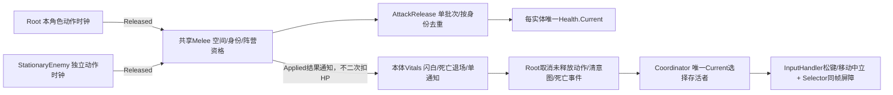

# M02-B1 真实攻防与死亡交接候选审查

本轮仅B1，不是全部M02B。用户执行v1.0附件，起点6263eda；R1/A/C的功能候选与既有源码审查仍未获用户逐行批准。本轮通过也不自动改变那些状态。

## 实际链路与唯一写入权

### 1. 生命与战斗身份

Root显式初始化自己的可选Vitals，Health.Id等于ActorId；同一Prefab两实例各建独立Health。敌方由独立Enemy组件显式初始化自己Vitals，身份enemy-stationary-01。Vitals实现ICharacterLifeState/ICombatHitTarget，Root只读生命资格，不在Bus/Follow/Coordinator复制HP或isDead。`deathNotified`仅去重一次生命周期通知，不是生命真值；IsAlive始终读Health.Current。

Health.Current仍只有Health内部写入。新增RestoreForDevelopment显式恢复同一实例，保持Id/Maximum和旧Release去重，不重建角色或Health偷换引用。生产Update不调用恢复入口。开发旧靶CombatTestTarget保留，不担任真实敌人的宿主。

### 2. 伤害：Released先于HP，反馈在HP之后

玩家原BasicActionRuntime完全不改，Accepted不扣血。Melee先查物理范围，再用CombatTargetPolicy拒绝自身、死者、同阵营或无身份对象。Neutral保留旧开发靶兼容；无友伤是本轮技术候选，不是永久游戏规则。LayerMask只是空间过滤，不是敌我唯一权威。

来源若有Vitals，则必须活着且Health.Id匹配Release.ActorId，否则仅关闭一个空批次，不能把旧来源的释放凭据借给新实体。目标多Collider先合并同一适配器，AttackRelease仍按Health.Id去重。同一Release再次Resolve会明确拒绝；不会再次扣血。

Applied结果由Melee通知ICombatHitTarget.OnHitResolved；旧靶走原ShowHit。回调只闪白/死亡，不再次ApplyDamage。**审查点**：世界结算调用者必须把Applied结果交回目标；当前生产Melee及Development注入器均已实际执行，不能把未来绕过这条网关的直接Health调用视为已支持。

### 3. 死亡与退场

Health归零时IsAlive立即失效，Selector本帧读出即Neutral。Vitals只关闭本体Renderer和Collider（含CharacterController），保留Root/身份/Health对象和开发读取；没有downed/尸体/救援。随后单次Died回调让Root具名CancelAction(death:来源:ActionId)、清Follow和有效帧，再通知Coordinator。整条同步调用结束时取消、退场、交接均完成。

未Released的动作被取消后不再释放；已Released的真实HP效果不回滚。非实控死亡不取消存活者的动作或改Current；实控死亡只由Coordinator从原成员表选择活体。失焦/应用暂停期间也可完成身份交接，但原输入许可仍关闭。全灭Current=null，禁启组件不会恢复死人或退回多源玩家输入。

### 4. 死亡交接的Held规则

普通Tab保留原移动语义。只有死亡交接/开发重选额外调用ResetPlayerInput(requireMovementRelease:true)，等待实际WASD/摇杆回中后才重武装移动；攻击沿原attackArmed等待真实释放。Selector原代际/同帧屏障继续阻止残留帧。Root新增生命资格检查，但暂停状态仍能接收原P键，不用“关闭所有输入”偷换暂停机制。

### 5. 固定敌人是工程适配，不是正式AI

敌人固定位置，显式目标数组只用于此验证敌人的目标选择，不复制队伍Current。近距且射线无遮挡才请求自己的BasicActionRuntime；前摇中目标死去/出圈/被挡则具名取消。释放通过同一Melee→Release→Health链反向扣角色HP。敌人死亡或禁用/失焦也取消自身动作。

玩家样板原动作时间/伤害保留。工程样板：角色100HP，敌人72HP/20伤害/1.7触发半径/1.8秒请求间隔/.5秒Release；Inspector可改，不是正式平衡。不追击、不绕墙、不造敌人动画/掉落/技能。

### 6. 跟随和持久化边界

Follow数学和Director源码未改；它们通过Root.CanSimulateIntent/会话许可自然排除死者，不另存死亡计时。共享Prefab只加Vitals和Root引用，GUID及原Input/Follow/Spine接线保留。四旧场文件保持不变，但继承新Prefab，回归不是隔离旧程序版本。

新场Assets/OSSASTRA/M02B/SC_M02B1_CombatDeath.unity含两共享角色和一个几何敌人。没有友方头顶血条；开发面板读取真实HP、Alive、Current、来源、命中与死亡原因。Development按钮经真实Release/Health通知受击，显式同实体恢复；不是生产复活。正式10秒/.5秒返场、装备/体力/CD延续、架势/连段/敌人正式AI均未迁移。

## 实际失败与修复

首轮22项前身为21项、3失败：真实扣血后ShowHit的MaterialPropertyBlock为空，导致反馈异常；已用直接命中最小复现定位，改为显式Initialize创建，边界回归锁定“不抛异常且正确记录来源”。另一失败是夹具在新攻击前摇内期待移动，修为先移动后攻击的两条合法断言，生产MoveReady没有放宽。最终世界22项和边界15项分别通过，见[M02B1-verification](M02B1-verification.md)。

本轮新增/改源的完整行号、SHA和中文职责说明见[M02B1-source-review](M02B1-source-review.md)及manifest。所有变化仍待用户审查；[R1审查](M02C-R1-review.md)和旧账本保留，涉及Root/Selector/Coordinator/Input/Contracts的本轮变化重新待审。

## 本轮待审账本

| 文件 | 区间 | 状态 |
|---|---|---|
| Assets/OSSASTRA/Scripts/Characters/Core/CombatTargetPolicy.cs | 1–18 | 待用户审查 |
| Assets/OSSASTRA/Scripts/Characters/Core/Health.cs | 1–36 | 待用户审查 |
| Assets/OSSASTRA/Scripts/Characters/Core/AttackRelease.cs | 1–79 | 待用户审查 |
| Assets/OSSASTRA/Scripts/Characters/Runtime/CharacterVitals.cs | 1–88 | 待用户审查 |
| Assets/OSSASTRA/Scripts/Characters/Runtime/CharacterContracts.cs | 1–95 | 待用户审查 |
| Assets/OSSASTRA/Scripts/Characters/Runtime/CharacterRoot.cs | 1–206 | 待用户审查 |
| Assets/OSSASTRA/Scripts/Characters/Runtime/CharacterMeleeHit.cs | 1–44 | 待用户审查 |
| Assets/OSSASTRA/Scripts/Characters/Runtime/CharacterIntentSelector.cs | 1–72 | 待用户审查 |
| Assets/OSSASTRA/Scripts/Characters/Runtime/CharacterInputHandler.cs | 1–143 | 待用户审查 |
| Assets/OSSASTRA/Scripts/Characters/Runtime/CharacterControlCoordinator.cs | 1–171 | 待用户审查 |
| Assets/OSSASTRA/Scripts/Enemies/Runtime/StationaryMeleeEnemy.cs | 1–97 | 待用户审查 |
| Assets/OSSASTRA/Scripts/Development/Combat/CombatDeathDebugView.cs | 1–70 | 待用户审查 |
| PlayerCharacter.prefab / B1场 | 生命接线/敌人/开发入口 | 待用户审查 |
