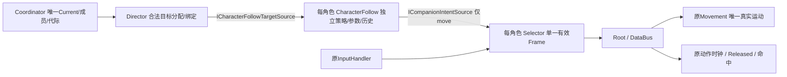

# M02-C-R1 集中架构审查入口

本轮是角色通用跟随能力重构，不是新玩法迁移。用户已反馈M02C功能正常，但未完成A/C/R1源码与架构审查；本轮候选发布也不代签。原[M02A](M02A-review.md)、[M02C](M02C-review.md)及[旧待审账本](M02C-review-ledger.md)保留为历史。

## 按这条链集中审查

1. **Coordinator（本轮源码不变）**：唯一Current和成员表，先于Root更新；控制代际、切换当帧屏障和Held武装沿用。
2. **Director（本轮收窄）**：唯一会话成员逐项预检，每角色存在合法Follow且未被其他分配者占用后，才提交绑定；中途失败只归还自己取得的绑定。`bindings`只保存需归还的Follow引用，不保存policy、位置、距离、受阻、Current或第二名单。`TryGetFollowTarget`每次从原会话返回当前目标，拒绝非成员/Current自身/无效会话。
3. **CharacterFollow（本轮新增）**：与Root同一GameObject，Root Awake在原Bus/必需子系统初始化后显式Initialize。每实例拥有自己的原CompanionFollowPolicy、lastPosition、revision、sampledTarget、state/reason。按外部分配目标产生move，MoveReady/权限/焦点/暂停/目标存活先行。没有自己的Update、InputAction、运动或动作时钟。
4. **Selector（最小调整）**：仍唯一选择Player/Companion/Neutral。角色源在发现新目标时会清旧Frame，因此先用局部selectedKind选择来源，读完后才发布本次kind，避免重置回调擦掉新来源身份。真实组件合同覆盖该路径。玩家Held和原始输入采集未改。
5. **Root/Bus/Movement（仅Root接线及失效通知改变）**：Root可选序列化Follow槽只接自己同物体能力，拒绝另一角色provider；不实现距离算法。暂停、失焦和Root禁用重置自身Follow历史；旧动作取消/推进语义保持。Bus/Movement/Orientation/Spine/Health/BasicActionRuntime源码未动。
6. **旧动作生命周期**：切人不取消已接受普攻，AI帧只带move，前摇MoveReady前不跟随，Released仍一次扣HP；真实世界合同复验。

## 新接口与真实消费者

仅新增`ICharacterFollowTargetSource.TryGetFollowTarget(CharacterRoot, out CharacterRoot)`，Director实现、角色Follow消费。复用原`ICharacterControlSession`和`ICompanionIntentSource`；不新增ICharacterAI/全局队伍Manager/可写Current。Root持有具体可序列化组件槽，Selector运行时依赖原窄意图契约。

## 参数和序列化迁移

迁移前真实读回旧Director参数2.4/1.6/.5/.5，Editor Prefab API新增Follow并将等值写入共享PlayerCharacter.prefab，Root.follow指向同体组件。原Prefab GUID及原组件/Spine引用保留；差异只增加组件、Root引用和4参数。旧Director4字段隐藏保留作序列化兼容，不参与运行；现在参数权威只在角色Follow。修改Play中的Inspector参数不会自动重建策略；当前按初始化配置使用，正式动态调参不是本轮功能。

独立场`Assets/OSSASTRA/M02C/SC_M02C_R1_CharacterFollow.unity`由干净旧M02C保存副本，保存重开读回。旧M01/M02A/M02C场文件字节保持；它们共享新Prefab和脚本，不能当作隔离旧程序版本。M01/M02A继承组件但无assignment，所以仍不跟随。

## 生命周期与只读观察

- 未分配、无合法目标、组件禁用、会话屏障或不可行动：能力输出零。IsAvailable会撤回已失效历史/Frame，但不推进策略时间；UI Observe只读且不调用Sample/Reset。
- 分配者只可重绑自己；错误owner不能清合法绑定，错误角色读源直接返回零且不动owner历史。Director禁用/销毁明确Unassign；单个Follow禁用仅清自身历史和帧，重启后从仍合法的分配源重新查询目标并重新采样，不能复活缓存move。
- 目标身份或ControlRevision改变均重置；A→B→A不继承旧受阻位置。无目标/焦点/暂停时清本体历史，避免恢复时把累积位移当一帧位移。
- Inspector新增只读CharacterFollowEditor，实时读取Observe显示状态/目标/距离/原因；无镜像状态、不进入Player程序集。开发面板直接读每个Follow的状态/阈值，可分别禁启本体和场景分配者。
- 保留原最小受阻语义：无绕墙、加速或传送；墙撤掉而领队静止时，仍需目标显著移动才重试。不支持Play中热改队伍成员表。

## 审查产物和范围

[完整变化源码、行号与解释](M02C-R1-source-review.md)、[SHA清单](M02C-R1-source-manifest.json)、[验证矩阵](M02C-R1-verification.md)。本轮7份生产/开发源码均有准确中文文件头，关键owner、失效、惰性采样与原动作边界有中文说明；所有变化区间仍**待用户审查**。这是新增能力组件、职责和绑定迁移；切控、原策略数学、位移与动作核心是此前已测但仍待审的既有功能。

本轮只做到R1。建议你按上方6步集中检查后，再选M02B或后续玩法；没有自动启动新阶段。

## 本轮待审账本

| 文件 | 行号范围 | 状态 |
|---|---|---|
| Assets/OSSASTRA/Scripts/Characters/Runtime/CharacterFollow.cs | 1–135 | 待用户审查 |
| Assets/OSSASTRA/Scripts/Characters/Runtime/CompanionFollowDirector.cs | 1–71 | 待用户审查 |
| Assets/OSSASTRA/Scripts/Characters/Runtime/CharacterRoot.cs | 1–186 | 待用户审查 |
| Assets/OSSASTRA/Scripts/Characters/Runtime/CharacterIntentSelector.cs | 1–72 | 待用户审查 |
| Assets/OSSASTRA/Scripts/Characters/Runtime/CharacterContracts.cs | 1–87 | 待用户审查 |
| Assets/OSSASTRA/Scripts/Development/Combat/CompanionFollowDebugView.cs | 1–52 | 待用户审查 |
| Assets/OSSASTRA/Scripts/Development/Editor/CharacterFollowEditor.cs | 1–32 | 待用户审查 |
| PlayerCharacter.prefab / R1独立场 | 新组件、引用与阈值迁移 | 待用户审查 |
