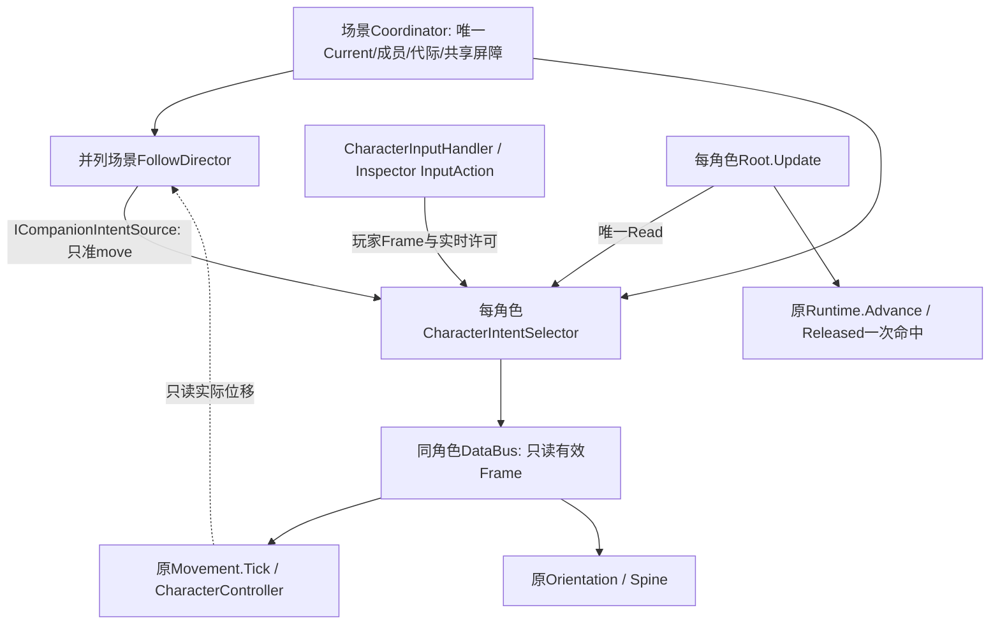

# M02-C 最小伙伴跟随候选｜实际架构与试玩

基准GitHub main@8925b76；本轮候选待用户审查。新场：`Assets/OSSASTRA/M02C/SC_M02C_FollowControl.unity`。原M01/M02A场、共享PlayerCharacter.prefab与素材保持。

团结中打开新场→Play→点击Game View。WASD移动，Tab/手柄Select切人，鼠标左键沿原系统单次普攻。另一名角色在距离超过启动阈值时直接追随，进入停止区停止。左侧开发面板显示唯一Current、各角色Player/Companion/Neutral来源、目标、距离、阈值、状态与原因。跟随禁启/重置/检查均调用真实入口；原F1–F4可复验单角色合法/禁攻/清理/检查。

这仍是两份同Spine临时实例，不是主角/女主角完整美术迁移。没有AI攻击、复杂寻路、赶队加速、传送、战斗HP/死亡、连段、跨场景队伍或存档。本轮结束停在M02-C。

## 唯一状态与实际通信

| 状态 | 唯一持有者 | 本轮消费者/变化 |
|---|---|---|
| 当前实控身份/成员 | 原CharacterControlCoordinator | 新ICharacterControlSession只读暴露；没有第二Current或ActorId名单 |
| 原始玩家输入 | CharacterInputHandler | 原Action/许可/松键逻辑不改；增加可选ICharacterInputAvailability给外层同步撤权 |
| 本角色有效Frame | CharacterIntentSelector | Root Awake创建、同一对象注入Bus；只选择Player/Companion/Neutral之一 |
| 伙伴滞回/受阻历史 | Director内每角色CompanionFollowPolicy | 非角色动作状态；只产move，不调用位移/Spine/HP |
| 身份/动作时钟/事实 | 原BasicActionRuntime | Root依旧唯一Advance，切走继续已接受动作，无额外时钟 |
| 运动/碰撞 | 原CharacterMovement/CharacterController | 读取Bus有效move；实际位移再供跟随受阻诊断 |
| 显示/攻击方向与Spine | 原Orientation/SpineView | 经原输入/动作链更新，跟随不直接操纵骨骼 |
| 命中/HP | 原Melee/AttackRelease/Health | 保留原单普攻与开发靶，不引入新生命系统 |

Selector是plain C#对象，没有另一个Update或预制体组件。Director在Start（所有Root Awake之后）统一检查后绑定；不是靠偶然Awake遍历顺序。协调者原Update(-200)→Root(-100)保持，选择器在Root惰性Read时选源。Director本身没有Update。

Root公开的最小绑定API只是把场景provider注入现有ICharacterInputSource入口；原接口足以让Bus/Movement保持不动，新增Root seam是因为旧Awake固定`inputSource=input`，场景无法为本角色接伙伴源。没有在Root叠加第二次Move。

## 接线/接口的真实消费者

- 新场CharacterControlSession对象保留原Coordinator，新增CompanionFollowDirector.coordinator指向它；新增CompanionFollowDebugView.director指向Director。旧CharacterControlDebugView仅在新场禁用，避免两份面板重叠。
- 共享角色Prefab不新增全队组件。Root仍序列化原InputHandler/Movement/Orientation/View/Melee/Camera槽，各实例独立ActorId temporary-a/b。
- ICharacterControlSession由Coordinator实现，Director与Selector读取；新增只读ControlRevision/IsIntentSamplingAllowed，不改变Current持有者。
- ICompanionIntentSource由Director实现、Selector消费；伙伴返回帧强制只拷贝move，不能注入attackHeld/cancel/pause/debugCommand。
- ICharacterInputAvailability由原InputHandler实现、Selector消费。必要性来自真实旧场RED：原始Frame已清零而外层同帧仍保留旧move；该接口使无Director的M02A也即时撤回外层Frame，避免依赖具体InputHandler类型或新增可写状态。

## 来源移交、生命周期与候选取舍

1. 无Director绑定：Selector委托原玩家适配器；M01保持单角色，M02A非实控仍由原玩家许可返回空帧，不自动跟随。
2. 有Director：会话失效/无Current/当帧屏障优先Neutral；Current只Player，非Current且provider可用才Companion。Selector不计算距离、不直接读设备。
3. 本帧有效Frame必须是本帧采样、Root启用、会话许可/代际一致。原玩家许可被撤回或伙伴provider禁用也即刻失效，Bus不会继续显示旧来源移动。
4. 原玩家Raw Frame和Selector有效Frame用途不同：前者仅设备采样，后者唯一供Bus执行；没有两套角色HP/动作状态。新Current仍必须实际松开攻击，Selector清帧不伪造松键。
5. 切人先由原Coordinator移交并递增代际，共享一帧屏障同时阻止新旧玩家/AI叠加。下帧各Root继续自己的Update，原攻击不因切人取消。非实控前摇MoveReady=false只输出零move，释放保留原方向，恢复后才可跟随；Ready跨越当帧可能延后一帧采意图。
6. 焦点/应用暂停变化递增代际；原Root焦点取消/暂停时钟语义保持。玩家P键仍局部暂停，但领队暂停时其伙伴也不继续追它；没有新增全局暂停服务。
7. Director禁用清自己的策略/有效帧，玩家仍受原会话管理；启用重新绑定/采样。第二Director不得替换活provider；失败/禁用Coordinator不得通过Director抢占原选择器。失效目标、Root禁用/不可行动、没有移动许可均零意图。
8. 停止距离1.6、启动2.4、受阻窗口.5秒、领队移动.5单位重试，均为Inspector可调候选。沿原速度3，无赶队加速。角色半径.22，停距大于安全间隔；不改体素/Spine比例。
9. Blocked只在前帧确有跟随命令而水平实际位移小于.002累计到窗口后成立。不会因空闲、暂停或动作前摇假判受阻。受阻后停止尝试，领队显著移动才重新尝试。**无绕墙导航；墙撤掉但领队不动时需领队再移动才能恢复。**
10. Director字典是各成员策略缓存，不是第二队伍名单，成员输入来自原会话。没有静态全局角色、ServiceLocator、行为树或跨场景宿主。本轮不支持Play中热改Inspector成员表。

## 读取依据与差异

用户v1.0全文已读；原型Origin/design/开发细则.md与CurrentRules、T015/T016跟随/让权相关记录只读对照。较新原型有软阵型、加速档、Z切人/战斗自治；本轮明确只做固定速度直接追随、Tab/Select和原已接受动作继续，不照搬历史实现。
新ChatGPT对话read_thread可见用户接续消息，助手正文仍为content-reference；未声称读到不可见全文，实施依据为用户当前执行指令、完整附件与真实源码。

## 审查与后续

本轮新增/修改9份源的最终行号、SHA、完整源码与语句块说明见M02C-source-review.md / M02C-source-manifest.json；中文注释核对见M02C-comments.md。独立M02C-review-ledger.md全为待审，保留M02A历史审查记录。
验证分别列于M02C-verification.md，不把不同合同相加包装成“一个完整总套件”。人工跟随距离、卡墙与实控手感以及架构/命名均待用户审查；不自动开始M02-B或M03。
