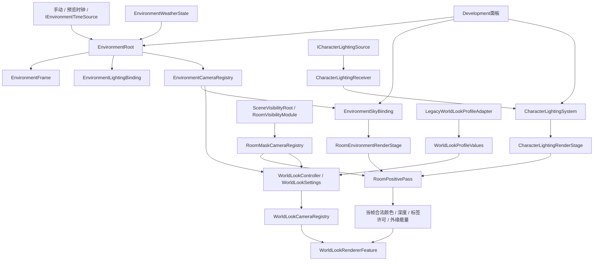

# RENDER-ARCH-01 架构与接入

本轮在既有URP 3D合法世界链路上加固边界与生命周期，保留现行45°视角、两角色独立v1.2光感配置和原Shader算法。这里描述源码职责；验证结论及未完成项见[验证与限制](验证与限制.md)。

## 依赖与提交顺序

面板是消费方和调参适配方，生产模块不反向引用具体Development面板。SceneVisibilityRoot的可选显示资格来源为`ISceneRenderView`；它不授予房间观察权，也不要求引用MapResearchRoot具体类型。

单相机流程：先由房间模块提交合法表面；剔除前准备源材质与核心预算，同时预检环境工作集；核心Pass重建合法世界颜色和深度，独立阶段依次处理环境、角色覆盖及外缘；完成后才发布本帧合法附件给WorldLook。外缘使用独立能量，避免被后续环境表现再次扩散。过期附件不能跨相机或跨未完成帧继续使用。

## 所有权

| 所有者 | 持有与负责 | 不拥有 |
| --- | --- | --- |
| EnvironmentRoot | 环境求值、时间接入、天气状态、显示登记；提交照明后通知消费者 | 玩家业务日历、房间许可、UI、天空RT |
| EnvironmentWeatherState | 天气当前值/目标值、混合进度、确定性调度 | Camera、Renderer、显示登记 |
| EnvironmentLightingBinding | 原生灯与RenderSettings照明借用/归还 | 房间显隐、人物材质、天气调度 |
| EnvironmentSkyBinding | 天空/反射/雨材质、反射Cubemap、雨深度、按需预览RT；环境工作集 | 环境状态、房间观察权、开发面板 |
| RoomPositivePass | 核心合法世界附件、材质桶、属性借用范围、黑幕历史与绘制顺序 | 角色覆盖/外缘资源、天气状态 |
| RoomEnvironmentRenderStage | 可选环境命令构造与局部降级 | SkyBinding的材质/RT |
| CharacterLightingRenderStage | 单相机Coverage与OuterGlow缓存、故障状态与恢复 | 角色生命/动画、房间许可、最终颜色权威 |
| CharacterLightingReceiver | 本实体身体/装备成员、独立运行参数、活动登记 | 原Renderer显隐、源材质、装备实例 |
| WorldLookController / Feature | 配置快照与相机登记 / Look自有附件和材质 | 房间许可、真实照明、源Profile写入 |
| 两个Development面板 | 自有Canvas、输入租约、显式预览申请与诊断委托 | 生产模块更新循环、全局参数恢复权 |

禁用、切相机或销毁时，各所有者只撤销自己的登记和借用范围。EnvironmentRoot撤销显示不清空天气状态；无相机时仍可求值和推进。天空预览没有消费者时不申请RT；面板改绑、清空、折叠及禁用均撤销旧申请。

## 故障隔离

| 故障 | 处理范围 | 保留能力 / 诊断 |
| --- | --- | --- |
| 天空、反射、雨、雨深度Shader缺失或不支持 | 各自暂停；反射归还自己的借用 | 其他可用能力与有效环境帧保留；读取各Ready/Status |
| 环境工作集非法或超预算 | 关闭本帧自有环境Shader贡献及雨，不截断数据 | 合法世界与Look继续；SurfaceStatus给出原因，天空独立 |
| 环境消费者通知抛异常 | 逐订阅者隔离，继续后续通知 | 已提交环境/照明不撤销；记录ConsumerFaultCount与LastConsumerFault |
| 环境Surface/Sky/Rain命令构造异常 | 丢弃该阶段半成CommandBuffer；Surface额外清除自有全局开关 | 核心合法世界继续，阶段记录错误 |
| Coverage或OuterGlow命令构造异常 | 对应可选阶段局部停用，按配置签名锁存 | 原主体/核心世界保留；配置或成员变化可恢复 |
| 核心空间/材质/附件不合法，或缺少剔除前准备 | 保守拒绝核心绘制，不发布完成附件 | 不使用旧世界冒充合法视野；RoomMaskStatistics.Error说明原因 |
| Look缺配置适配器、适配器被销毁或类型不符 | 撤销本控制器Look登记 | 不撤销上游环境和房间许可；Controller.Status说明原因 |
| 底层GPU命令提交失败 | 交核心安全路径报告 | 不宣称已回滚GPU，也不伪报为成功局部恢复 |

环境工作集固定容量为相关房间体积32、有效点灯8、有效雨棚16。点灯先过滤空、禁用、非Point、无有效强度/范围及重复引用，再按当前相机相关性计数。房间还保留相关灯所在体积，避免把室内灯误当室外灯；雨棚不能仅因薄顶板位于画外而忽略。容量不足明确拒绝，不静默截断空间。

Editor绘制使用`RenderPassReadiness.Ensure(material, pass)`检查实际需要的Pass，必要时同步编译；`RenderCommandScope`只对自己的CommandBuffer配对关闭/恢复异步编译策略。它们不改项目全局选项、不全量Warmup。首次新变体可能等待编译。

## 最小接入步骤

1. 使用实际URP 3D的UniversalRenderer，明确登记Camera，启用并填齐RoomMaskRendererFeature与WorldLookRendererFeature的Shader引用。当前认证路径关闭Camera内建后处理，避免借用未认证旧深度。
2. 创建EnvironmentRoot，绑定昼夜、初始天气、可选气候和明确时间来源；连接EnvironmentLightingBinding的原生灯。创建EnvironmentSkyBinding，指向同一EnvironmentRoot，显式登记Shader、房间、点灯和雨棚。
3. 接入既有SceneVisibilityRoot/RoomVisibilityModule的合法帧生产链。`renderViewSource`可为空，或引用实现`ISceneRenderView`的组件。生产控制器仍依赖真实观察者/房间上下文，不用测试Probe替代。
4. 每实体配置CharacterLightingReceiver：同一Camera、明确身体Renderer、独立Profile。玩家由PlayerCharacterLightingSource适配原角色根；独立渲染实体可用RendererLightingSource。业务NPC/敌人应由自身根实现`ICharacterLightingSource`，只提供Owner、EntityId、IsAvailable和已提交装备Renderer，并明确调用Initialize/TickPresentation及禁用撤销。身体与装备必须属于Owner层级。
5. 创建CharacterLightingSystem，连接同一Camera、SkyBinding、接收者和Coverage/OuterGlow Shader。不要从业务根创建角色增强RT；资源由CharacterLightingRenderStage负责。
6. 创建WorldLookController，绑定同一Camera及真实可视性上下文。使用旧作者Profile时，显式添加LegacyWorldLookProfileAdapter并填入profileAdapter；适配器只捕获31项纯值，运行层不引用旧Profile具体类型。其他作者格式可实现IWorldLookProfileAdapter。
7. 不添加Development面板也应能运行。需要调试UI时，从面板显式连接environment/skyBinding/lightingSystem。不要恢复生产对象指向面板的旧调用；previewConsumer仅保存旧序列化引用供迁移。

独立Smoke使用测试命名空间的固定许可帧，验证渲染接入；它没有真实房间/玩家上下文，不能据此声称生产WorldLookController或普通NPC业务已迁移。主场Controller成功验证与Smoke测试分别记录。

## 诊断入口与定位顺序

先读EnvironmentRoot.Status与Current，再读EnvironmentCameraRegistry.RegisteredCameraCount；有消费者错误时读取两处ConsumerFaultCount/LastConsumerFault。随后读SkyBinding的SurfaceStatus与Sky/Reflection/Rain/Preview Ready/Status，判断单一可选能力还是数据预算问题。

核心显示异常看RoomMaskCameraRegistry.TryGetStatistics返回的Error、附件尺寸、Draw和资源计数。角色增强看CharacterLightingSystem的CoverageActors/Draws/Bytes、OuterGlowDraws/Bytes/Status及Describe；阶段内部有CoverageError/OuterError。Look看WorldLookController.Status/Current与WorldLookRendererFeature.Status/ActiveCameraCount/OwnedTextureCount。

只调整所属模块的明确配置后重试。不要用扩大视野、移除黑幕、改写源材质或全局关闭编译选项掩盖局部故障。EnvironmentRoot和WorldLookController的OnValidate只标记工作，实际重采样/撤销在主线程执行。
