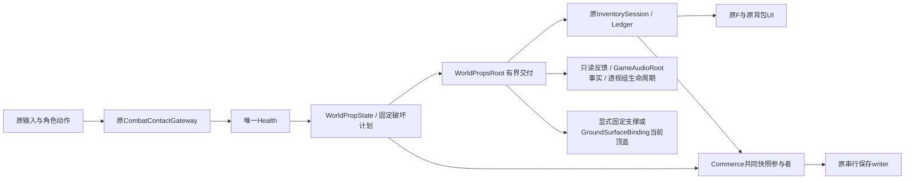

# WORLD-PROP-01 基线、依赖与交付范围

目标工程为 `E:/WORLDCREATOR/new/Project_ANKALUTE`，基准 `c1226cc494411a304f3d75027ad14e20941e9353`；Tuanjie 2022.3.62t16 / 1.10.4，Input System 1.14.4，URP 14.2。按用户附件00—05执行，聊天链接未取得可读正文。原37项dirty和197份已有参考文件均建立并核对独立保护基线；完整本机材料位于 `E:/WORLDCREATOR/XingHaiHuiLang/研究/场景物破坏与掉落/WORLD-PROP-01/`。



- WorldProps不引用EnemyRoot或角色控制状态实现，不拥有第二个Current、输入采样、HP、背包、钱包或文件writer。角色/敌人API与旧场控制代码保持原有权威。
- Core只依赖原Health和纯状态；Runtime是组合/命中适配；Presentation无独立Update/音源；Integration限定落点与既有库存/保存接口。未为目录制造空asmdef。
- 既有共享改动仅Health严格快照恢复、Ledger批次发布、typed世界散落/原交互与显示预算、Commerce显式快照参与者、两条确切地表样板白名单。新场是独立Map身份/缓存，原场不作为写入目标。
- 模板与SO在 `Assets/OSSASTRA/WorldProps/`；最终17实例、`worldprops-demo-01`；旧proof/stress档保留。原作媒体、派生Mesh、场景/Prefab含受限依赖，均仅本机，不混入公开源码提交。
- 两作研究分静态确认与动态未知。《饥荒》Workable/PICK/DIG不等同战斗HP；《开拓物语 Demo》真实体积石/Plane草/混合树共享采集处理，但原保存/工作量规则不直接照搬。详本机两份研究及离线HTML。
- 纯测试命令见下。多个csproj通过本目录Directory.Build.props隔离obj/bin，不共用增量缓存/apphost。相关原持久层41项另有限定证据；不扩大为全工程历史验收。

```powershell
dotnet run --project Candidates/WORLD-PROP-01/CoreTests/CoreTests.csproj --configuration Release
dotnet run --project Candidates/WORLD-PROP-01/InventorySeams.Tests.csproj --configuration Release
dotnet run --project Candidates/WORLD-PROP-01/InventorySeams.Participants.Tests.csproj --configuration Release
dotnet run --project Candidates/WORLD-PROP-01/InventorySeams.LegacySession.Tests.csproj --configuration Release
```

[使用指南](使用指南.md)与[验收报告](验收报告.md)记录实际入口、证据范围和未测项。

**保护例外：**旧入口临时场复制失败后仍启动原场，导致默认 `commerce-main` 档被本次会话自动保存覆盖。它不在上述源文件SHA保护结论中；没有启动前完整副本，不自动恢复/重置时间。[事故说明](旧档误入事故说明.md)单独记录这次失误、现状保留和可确认的影响边界。
