# 《逃离鸭科夫》R1 系统地图：静态导航

- 取证范围：`D:\steam\steamapps\common\Escape from Duckov\Duckov_Data\Managed` 中三份本机 Mono 程序集；2026-10-25 只读扫描。
- Core `TeamSoda.Duckov.Core.dll`：`298d5d5885427632d5a94b2f3ce587f8ebc9528ec71e575a475158c326ecae8f`；ItemStats `ItemStatsSystem.dll`：`a276e15c022f71b2214bd05e1b9b0f2e620c16561df576fed0b79c2fe4402e60`；`Assembly-CSharp.dll`：`e5f6f893763d3bfdd49c4c4e778f54562cab2ef237023c2c87c3806a8895e8cf`。
- 导航数据：[类型与调用入口索引](类型与调用入口索引.csv)；只读扫描原表：类型（本机中间材料，未发布）、方法（本机中间材料，未发布）、调用（本机中间材料，未发布）、字段访问（本机中间材料，未发布）。以下 IL 偏移均可在这些表内按程序集、令牌和方法检索。

## 读图规则

**类型、字段和签名存在**由元数据直接确认；**调用和 `stfld`** 由方法体 IL 静态确认。`callvirt` 只说明编译时引用目标，不独自证明运行时虚派发目标。异步 `UniTask` 方法的业务调用一般位于编译器生成的 `<方法>d__…::MoveNext`。类名、字段名及有 `SaveData` 类型，均不独自证明所有权、业务规则或实际存档时机。表中的“候选”是下一轮定位线索；条件分支及完整成功路径仍需逐块核查。

下图实线只表达已查到的 **IL 静态调用/写入**，不表示箭头上的每一步在一次操作中必然执行。虚线表达仍待核对的概念关联。

```mermaid
flowchart LR
  IP["InteractablePickup.OnInteractStart"] -->|"calls IL_000C"| CM["CharacterMainControl.PickupItem"]
  CM -->|"calls IL_001D"| CIC["CharacterItemControl.PickupItem"]
  CIC -->|"TryPlug=false 且主角; calls IL_0068"| SP["ItemUtilities.SendToPlayerCharacterInventory"]
  CIC -->|"另一条件支路; calls IL_0082"| AM["ItemUtilities.AddAndMerge"]
  SP -->|"参数 true 时; calls IL_0049"| AI["Inventory.AddItem"]
  SP -->|"参数 false 时; calls IL_0054"| AM
  AI -->|"calls IL_002B"| AA["Inventory.AddAt"]
  AM -->|"calls IL_00A1"| AA
  AA -->|"List.Add / set_Item IL_013C/0157"| LC["Inventory.content 列表变动"]
  AA -->|"calls IL_016F"| NA["Item.NotifyAddedToInventory"]
  NA -->|"stfld IL_0002"| II["Item.inInventory"]
  LC -.->|"实际失败与覆盖边界待核"| Q["R2 事务研究"]
```

`ITEM-001` 在**非堆叠物品、主角、`TryPlug=false`、存在合法空位且 `AddAt` 校验通过**的条件下，可由交互入口追到容器写入；逐跳条件与失败边界见 [ITEM-001 拾取入包调用链](../10-证据索引/ITEM-001-拾取入包调用链.md)。这个图包含不同分支：`CharacterItemControl.PickupItem` 还在 `IL_00A8` 引用 `ItemExtensions.Drop` 作为失败路径；`ItemUtilities.AddAndMerge` 在调用 `Inventory.AddAt` 后丢弃其布尔返回值，所以不能单凭 `AddAndMerge == true` 判断新增成功。`Inventory.AddAt` 的前置失败及已占位置处理应以 [研究问题及假设](研究问题及假设.md) 的 R2 核验项继续追踪。

## 领域与候选权威

| 领域 | 实际程序集与入口 | 当前能确认的状态或关系 | 权威判断与缺口 |
|---|---|---|---|
| 物品定义、实例、属性 | ItemStats：`ItemAssetsCollection` (`0x02000005`)、`Item` (`0x0200001C`)、`ItemTreeData` (`0x0200002B`) | `ItemAssetsCollection.InstantiateAsync(int)`；`Item` 有 `typeID`、`maxStackCount`、`quality`、`weight`、`inventory` 字段及 `Combine/Split`；`ItemTreeData.FromItem` 被物品保存入口调用。 | `Item` 为运行实例候选，集合为资产/定义入口候选。typeID 与配置资源映射、实例 ID 生成及复制语义未证实。 |
| 容器、装备、随身、仓库 | ItemStats：`Inventory` (`0x0200001A`)、`Items.Slot/SlotCollection`；Core：`ItemUtilities` (`0x02000114`)、`CharacterItemControl` (`0x02000060`)、`PlayerStorage` (`0x02000115`)、`SavedInventory` (`0x02000106`) | `Inventory.AddAt` 调 `List<Item>.Add/set_Item` 并触发通知；`Item.NotifyAddedToInventory` 在 `0x0600015A/IL_0002` 写 `Item.inInventory`；`PlayerStorage.Save` 调 `ItemSavesUtilities.Save(Inventory,string)`。 | `Inventory.content` 是已见到的直接列表变更点；格位验证、装备槽与仓库缓冲区的完整所有权/失败一致性未证实。 |
| 地面拾取、箱子搜寻 | Core：`InteractablePickup` (`0x020000F2`)、`InteractableLootbox` (`0x020000F1`)、`LootBoxLoader` (`0x0200044F`)、`LootSpawner` (`0x0200044D`) | 拾取入口调用 `CharacterMainControl.PickupItem`；`LootBoxLoader` 的 `Setup` 状态机在 `IL_02A2` 实例化物品、`IL_0327` 调 `Inventory.AddItem`、`IL_0364` 调地面 `Drop`；`LootSpawner` 的 `Setup` 状态机在 `IL_021C` 实例化、`IL_02AE` 调 `Drop`。 | 生成路径是静态引用。随机何时触发、箱子库存是否持久及搜寻计时/重复生成仍未知。 |
| 尸体、死亡掉落 | Core：`Duckov.DeadBodyManager` (`0x02000271`)、`LevelManager` (`0x02000126`) | `DeadBodyManager.RecordDeath` 在 `IL_0058` 调 `ItemTreeData.FromItem`，`IL_0068` 调 `AppendDeathInfo`；`LevelManager+<CharacterDieTask>d__135.MoveNext` 引用 `RecordDeath`、`CreateFromItem`、`DestroyAllItem`、`DropAllItems` 和 `SaveFile`。 | 调用存在；不同配置/场景条件的实际资产去向及尸体重建规则未证实。 |
| 任务 | Core：`Duckov.Quests.QuestCollection` (`0x0200037B`)、`Quest` (`0x0200037A`)、`QuestManager` (`0x0200037E`)、`Task` (`0x02000381`)、`Reward` (`0x0200037F`) 及子类 | `QuestManager.ActivateQuest` 在 `IL_0030` 调 `activeQuests.Add`；`Quest.TryComplete` 调 `AreTasksFinished` 后调 `set_Complete`，后者在 `0x06001E30/IL_0002` 写 `complete`；`SubmitItems.Submit` 修改堆叠及 `submittedAmount`。 | Quest/Task 是运行状态候选；`QuestCollection` 为配置入口候选。可接取验证、目标事件订阅、重复奖励与保存顺序未完成。 |
| 商品、交易、资金 | Core：`StockShopDatabase` (`0x02000175`)、`Duckov.Economy.StockShop` (`0x0200036D`)、`Cost` (`0x0200036C`)、`EconomyManager` (`0x0200036B`) | `StockShop+<BuyTask>d__58.MoveNext` 引用 `Pay`、实例化、交付物品及 `Entry.set_CurrentStock`；`StockShop+<Sell>d__59.MoveNext` 引用 `Detach/DestroyTree`、`Cost.Return`、`EconomyManager.Add`；`EconomyManager.set_Money` 在 `0x06001D46/IL_001A` 写 `money`。 | `EconomyManager.money` 是已见账户字段写点；`CashItemID` 字段提示现金物品并存的可能，但支付条件、商店库存权威和失败原子性待查。 |
| 撤离、局内局外、保存 | Core：`LevelManager`、`RaidUtilities` (`0x02000197`)、`Saves.SavesSystem` (`0x02000255`)、`Saves.ItemSavesUtilities` (`0x02000254`)；ItemStats：`ItemTreeData/InventoryData` | `LevelManager.NotifyEvacuated` 直接引用 `SaveMainCharacter`、`CollectSaveData`、`SaveFile`；`SaveMainCharacter` 引用物品树保存；`SavesSystem.SaveFile` 在 `IL_0059` 调 `ES3.StoreCachedFile`。任务、经济、仓库各有 `Save` 入口。 | 存档入口与多类 provider 候选已定位；事件订阅顺序、撤离结算前状态归属和重载一致性未证实。 |

本次按关键类型/签名筛选时，主要导航点落在 Core 与 ItemStats。`Assembly-CSharp.dll` 已扫描，但不能据此断言其没有领域调用；跨程序集与间接回调还需按引用反查。`LootManager` 类型存在，当前没有把它的名字直接解释为战利品权威。

## 两处可复查的跨域静态路径

1. **任务货币奖励到字段写入（`ECON-001`）**：`Duckov.Quests.Rewards.QuestReward_Money::OnClaim` (`0x0600209A`) 在 `IL_0010` 调 `EconomyManager::Add(long)` (`0x06001D54`)；后者在 `IL_0016` 调 `set_Money(long)` (`0x06001D46`)；setter 在 `IL_001A` `stfld EconomyManager::money`，`IL_002B` 调 `OnMoneyChanged.Invoke`。`Reward::Claim` 虚调用 `OnClaim`，但具体实例是否为此子类及何时保存须另核。
2. **撤离通知到文件保存入口（`LIFE-001`）**：`LevelManager::NotifyEvacuated` (`0x06000A35`) 在 `IL_0023/0028/002E` 依次引用 `SaveMainCharacter`、`SavesSystem.CollectSaveData`、`SavesSystem.SaveFile`；`SaveMainCharacter` 在 `IL_0018` 调 `ItemSavesUtilities.Save(Item,string)`，其在 `IL_0001` 从物品构造 `ItemTreeData`、`IL_000E` 调 `SavesSystem.Save`。`SaveFile` 最终在 `IL_0059` 引用 `ES3.StoreCachedFile`。这仅证明方法体内的静态顺序，尚未证明所有撤离结果均进入此入口。

## 目前的边界

- 本轮未读取资源表、任务 prefab 或实际存档，也未运行游戏。静态调用图不提供运行频率、配置分支或成功率。
- `StockShop.Buy/Sell`、`LootBoxLoader.Setup` 等是异步包装；业务调用来自相应 `MoveNext`，见索引中的独立行。
- `Inventory.AddAt` 与账户 setter 有真实写入锚点；其他“权威”仍以候选称呼。完整交易、任务、死亡与撤离链属于后续 R2–R6。
- 待证问题和可执行的下一步见 [研究问题及假设](研究问题及假设.md)。
