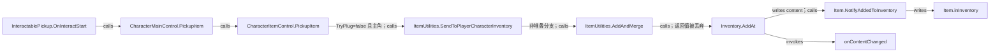

# ITEM-001｜地图拾取进入背包的静态调用链

- 取证对象：本机 Steam build `24013657`、游戏标识 `2.3.30`；Unity `2022.3.62f2`、Mono。
- 核心文件：`TeamSoda.Duckov.Core.dll` SHA-256 `298D5D5885427632D5A94B2F3CE587F8EBC9528EC71E575A475158C326ECAE8F`；`ItemStatsSystem.dll` SHA-256 `A276E15C022F71B2214BD05E1B9B0F2E620C16561DF576FED0B79C2FE4402E60`。
- 证据级别：`DIRECT_CODE`，只证明下述 **条件分支的静态代码路径**。未启动游戏、未实测拾取、未确认具体地图配置或存档时机。
- 可复核材料：`_work/metadata-scan/README.md`（本机中间材料，未发布） 的只读扫描器与 `targeted/*.json`；每个方法由下表的程序集、token 和 IL 偏移定位。扫描器解析 PE/CLI 元数据及 IL，不执行游戏代码。

## 条件分支与写入链

以下是 **非堆叠物品、目标角色为主角、装备插槽尝试未成功、背包有可写位置、`AddAt` 的校验通过** 时的一条路径。`TryPlug` 成功、堆叠合并和非主角路径另行处理，不能合并成同一条“入背包”结论。

| 步骤 | 实际方法与锚点 | 代码可见的动作 |
|---|---|---|
| 1 | Core `InteractablePickup::OnInteractStart(CharacterMainControl)` `0x060007E4`，`IL_0002–000C` | 从 `itemAgent.Item` 取得物品并调用 `CharacterMainControl.PickupItem`。返回 true 才在 `IL_0013–0022` 调 `OnPickupSuccess`；之后 `IL_0031` 调 `StopInteract`。 |
| 2 | Core `CharacterMainControl::PickupItem(Item)` `0x0600035C`，`IL_0006–001D` | `Health.IsDead` 为 true 直接返回 false；否则设置 `Item.Inspected=true`，再调用 `CharacterItemControl.PickupItem` 并返回其布尔值。 |
| 3 | Core `CharacterItemControl::PickupItem(Item)` `0x060002CA`，`IL_0000–008F` | 物品为 null 则 false。存在本角色 inventory 时，先 `ReleaseActiveAgent` 与 `Item.Detach`；调用 `ItemUtilities.TryPlug`。若它返回 true，直接视为拾取成功，但不意味着进入背包。本链仅追其 false 且 `IsMainCharacter=true` 分支，`IL_0068` 调 `SendToPlayerCharacterInventory(item,false)`。 |
| 4 | Core `ItemUtilities::SendToPlayerCharacterInventory(Item,bool)` `0x06000934`，`IL_0000–0081` | 物品、`LevelManager.MainCharacter.CharacterItem.Inventory` 缺失时返回 false。第二参数为 false 时在 `IL_0054` 调 `AddAndMerge`。其结果为 true 才在 `IL_006A`、`IL_007B` 分别调用 `OnPlayerItemOperation`、`OnItemSentToPlayerInventory` 事件（若有订阅者）。 |
| 5 | Core `ItemUtilities::AddAndMerge(Inventory,Item,int)` `0x06000931`，`IL_001E–00A8` | 对非堆叠物品跳至 `IL_0080`，取首个空位；结果小于 0 则 false。否则 `IL_0094` 再 `Detach`，`IL_00A1` 调 `Inventory.AddAt`。注意 `IL_00A6` 丢弃其布尔返回，`IL_00A7–00A8` 直接返回 true。 |
| 6 | ItemStats `ItemStatsSystem.Inventory::AddAt(Item,int)` `0x060000E4`，`IL_0000–0194` | 先拒绝 null、`position >= Capacity`、物品仍有 `ParentObject`。通过后 `IL_0157` 对 `content: List<Item>` 调 `set_Item(position,item)`；`IL_0168` 改 Transform 父节点；`IL_016F` 调 `Item.NotifyAddedToInventory`；随后树变化、重算重量、`onContentChanged` 事件，最后返回 true。 |
| 7 | ItemStats `ItemStatsSystem.Item::NotifyAddedToInventory(Inventory)` `0x0600015A`，`IL_0002` | `stfld ItemStatsSystem.Item::inInventory`，把物品的库存归属指向目标 Inventory；随后可触发 `onParentChanged`。 |

因此，**实际状态写入锚点**是 `Inventory.AddAt` 的 `List<Item>.set_Item`（`IL_0157`）和 `Item.NotifyAddedToInventory` 的 `stfld inInventory`（`IL_0002`）；`onContentChanged` 是已证实的通知入口，不能据此断言特定 UI 已刷新。此链尚未追到保存调用，不能据此断言拾取立即落盘。

## 失败与分支边界

| 条件 | 静态结果 | 锚点与未解处 |
|---|---|---|
| 角色已死亡 | `CharacterMainControl.PickupItem` 返回 false。 | Core `0x0600035C` `IL_0006–000E`；交互方不会发成功事件。 |
| 物品为 null | `CharacterItemControl.PickupItem` 返回 false。 | Core `0x060002CA` `IL_0000–000A`。 |
| `TryPlug` 成功 | `CharacterItemControl` 返回 true，可能是插槽/堆叠路径。 | Core `0x060002CA` `IL_003D–0057,008A–0090`；`TryPlug` 自身 `0x06000939` 有插槽与合堆分支，不能当作背包增加。 |
| `AddAndMerge` 找不到空位 | 返回 false；角色方法在 `IL_0091–00AF` 调 `ItemExtensions.Drop` 后返回 false。 | Core `0x06000931` `IL_0080–008D` 和 `0x060002CA` `IL_0091–00AF`。失败前已释放世界 Agent、调用 `Detach`，故不声称“状态完全不变”。 |
| `AddAt` 自己拒绝写入 | `AddAndMerge` 忽略其 false，仍返回 true；上层随后可能发成功通知。 | Core `0x06000931` `IL_00A1–00A8`；ItemStats `0x060000E4` `IL_0000–00E8`。这是**静态一致性疑点**，具体运行条件与后果待 R2 核查。 |
| `GetFirstEmptyPosition(start)` 在 `content.Count <= start` | 直接返回 `start`，此分支不比较 `Capacity`。 | ItemStats `0x060000E2` `IL_0007–0016`。若出现 `Capacity=0、start=0、Count=0`，后续 `AddAt` 会拒绝；尚未证明主角背包实际能处于该配置。 |

`Item.Detach`（ItemStats `0x06000154`）会尝试从插槽拔出或从原库存移除，均未把返回值传给调用方。因此本轮没有证明拾取迁移是原子事务，也没有证明失败后原世界对象必定原位恢复。`TryPlug` 内部也会丢弃 `Slot.Plug` 的布尔结果（Core `0x06000939` `IL_0248–024D`）；此处仅记录为 R2 的调查入口。

## 接续调查

1. R2 核对 `Inventory.AddAt` 的所有调用方是否保证目标位置合法、物品已脱离旧 owner；特别验证上表的返回值丢弃路径是否有实际可达配置。
2. R2 分别追 `Item.Combine`、`Slot.Plug`、`Inventory.RemoveAt` 与主动丢弃路径，建立所有权和失败矩阵。
3. R3 查 `InteractablePickup` 的 `itemAgent` 来源、世界对象移除/重建以及失败后的真实场景状态。
4. R6 再查拾取相关 `Save/CollectSaveData` 订阅和实际保存时机；当前只确认内存写入与事件。
